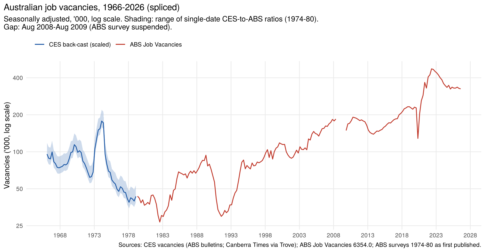

# Job vacancies: CES registered vacancies spliced onto ABS Job Vacancies

Australia had no ABS job vacancy survey until the 1970s. Before then the main measure
was the number of vacancies notified to the Commonwealth Employment Service (CES) and
still unfilled at the end of each month. This folder rebuilds that series from the
bulletins, seasonally adjusts it and scales it to the level of today's ABS Job
Vacancies series (6354.0), giving one quarterly vacancy series from 1966 to 2026.

## Steps

1. **Transcribe** (`R/build_ces_vacancies.R`). CES unfilled vacancies, Australia, by sex
   (1962–75 issues) or adults/juniors (1976–78 issues), from the ABS/CBCS
   *Employment and Unemployment* bulletins, plus ABS *The Labour Force* May 1979
   (Table 25), which carried the CES table to May 1979. Monthly with no gaps from
   Dec 1965 to May 1979, plus June figures for 1962–65.
   - Dated rows ("2 July 1965") are mapped to the month they measure: a Friday in the
     first week belongs to the previous month's end.
   - Checks: every row's parts sum to its printed total except one misprint (Dec 1970,
     corrected by the June 1971 issue). Of 157 months, 52 appear in two issues and all
     agree apart from that misprint.
2. **Seasonally adjust** (`R/seasonal_adjust_and_splice.R`). STL on log vacancies,
   robust, seasonal window 7. Mean absolute difference from the seasonally adjusted
   totals the ABS printed: 2.0% (Mar 1970 – Jan 1971) and 3.5% (Apr 1978 – May 1979).
   Set `USE_X13 <- TRUE` to compare with X-13 if the `seasonal` package is installed.
3. **Splice**. The CES counts only notified jobs, so the ABS series is about twice as
   high. Scale factor **2.11**: geometric mean of current ABS / CES for the four months
   where both exist (May, Aug, Nov 1979, May 1980; CES figures after May 1979 from
   *The Canberra Times* via Trove). A cross-check chaining through the early ABS
   surveys (1974–80, as first published) gives 2.21. The chart's band is the range of
   single-date ratios from either method, **1.89–2.61**.

## Sources

Links to every source used here (bulletin scans, RBA, ABS and FRED tables) are in [`SOURCES.md`](../SOURCES.md).

## Files

| File | What it is |
|---|---|
| `data-raw/raw.tsv` | CES vacancies by sex, one row per printed table row (issue, page, date) |
| `data-raw/raw_adult_junior.tsv` | 1976–79 rows split by adults/juniors |
| `data-raw/handles.tsv` | ANU handle for each bulletin issue (link: `https://hdl.handle.net/1885/<handle>`) |
| `data-raw/ces_1979_80_points.tsv` | CES unfilled vacancies Jul 1979 – Jul 1980 from newspaper reports |
| `data-raw/abs_overlap.tsv` | early ABS vacancy surveys as first published, and the current ABS original series 1979–80 |
| `data-raw/abs_current_sa.tsv` | ABS Job Vacancies, seasonally adjusted, quarterly May 1979 – Aug 2026 |
| `output/ces_vacancies_monthly.csv` | CES vacancies, original, monthly, with source issue/page/URL |
| `output/ces_vacancies_sa_monthly.csv` | plus STL seasonally adjusted series and seasonal factors |
| `output/job_vacancies_spliced_quarterly.csv` | spliced quarterly series 1966–2026, '000, with low/high band |

## Caveats

- The CES share of all vacancies moved with the cycle (the ABS/CES ratio fell from 2.23
  to 1.97 within 1979–80), so the back-cast level is uncertain by roughly ±15%.
- No ABS data Aug 2008 – Aug 2009 (survey suspended).
