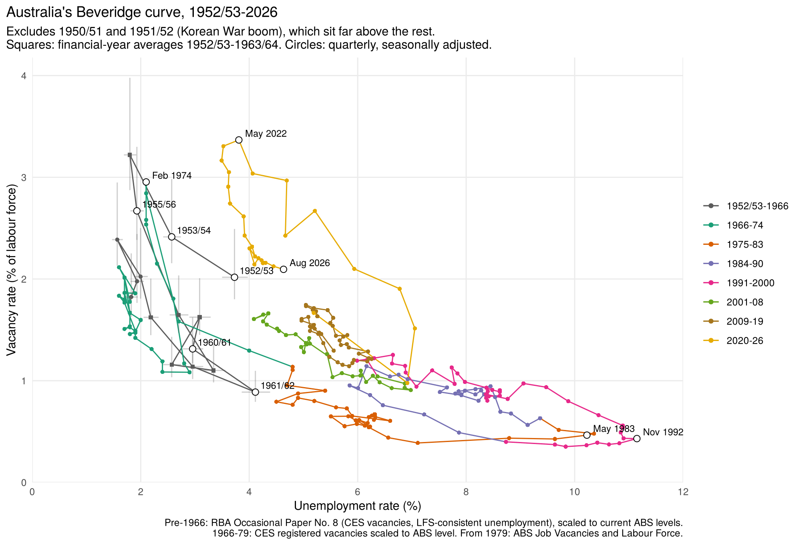

# Australia's Beveridge curve, 1950/51 – 2026

The vacancy rate (vacancies / labour force) plotted against the unemployment rate,
using the spliced vacancy series from [`01-job-vacancies`](../01-job-vacancies).

A longer write-up of the method is in the Claude Doc
[*Constructing a historical Beveridge curve for Australia, 1950/51–2026*](https://claude.ai/artifact/NHxc31LqrwaNapZimK68xz).

## Segments

| Period | Vacancies | Unemployment rate | Frequency |
|---|---|---|---|
| May 1979 – Aug 2026 | ABS Job Vacancies (6354.0), SA | ABS Labour Force Survey | Quarterly |
| Aug 1966 – Feb 1979 | CES vacancies, SA, × 2.11 | ABS Labour Force Survey (quarterly survey to Nov 1977) | Quarterly |
| 1950/51 – May 1966 | CES vacancies at end of June (RBA), SA, × 2.11 | RBA survey-consistent rate × 1.29 to the current basis | Financial-year averages, quarterly from 1964 |

## Steps

1. **`R/beveridge_curve.R`** (Aug 1966 – Aug 2026). Unemployment rate and labour force:
   OECD's copy of the ABS series on FRED (`LRHUTTTTAUQ156S`, `LFACTTTTAUQ647S`), which
   matched the ABS at every point checked; Aug 2026 from the ABS September 2026 release.
   The ABS presents the 1966–77 quarterly survey and the monthly survey from 1978 as one
   series, so no level adjustment is made.
2. **`R/beveridge_extend_1950.R`** (1950/51 – 1966).
   - Vacancies: RBA Occasional Paper No. 8 gives CES vacancies at the end of each June
     (its 1962–66 figures match the bulletin transcriptions exactly). Each June is
     divided by the June seasonal factor (0.825) and multiplied by 2.11; a financial
     year's level is the average of the two adjacent Junes, to line up with the RBA's
     financial-year-average unemployment rate.
   - Unemployment: the pre-1966 survey basis runs lower. For Aug 1966 the RBA gives 1.4%
     on the old basis and the ABS 1.8% on the current basis, so earlier rates are
     multiplied by 1.8/1.4 = 1.29 (rounding allows 1.21–1.37).
   - 1964–66 quarters: OECD quarterly unemployment and labour force (old basis × 1.29).

## Sources

Links to every source used here (bulletin scans, RBA, ABS and FRED tables) are in [`SOURCES.md`](../SOURCES.md).

## Files

| File | What it is |
|---|---|
| `data-raw/labour_force_quarterly.tsv` | unemployment rate and labour force, quarterly, Aug 1966 – Aug 2026 |
| `data-raw/u_rate_raw.txt`, `data-raw/lf_raw.txt` | the FRED series as downloaded |
| `data-raw/rba_op8_historical.tsv` | RBA OP8 tables 4.3, 4.14, 4.15 |
| `data-raw/oecd_lfs_1964_66.tsv` | quarterly unemployed and labour force, Feb 1964 – Aug 1966 |
| `data-raw/ces_registered_raw.tsv`, `ces_registered_revdef.tsv` | CES registered unemployed 1962–78, transcribed (not used in the curve; the CES definition narrowed in July 1973) |
| `output/beveridge_quarterly.csv` | the Aug 1966 – Aug 2026 curve |
| `output/beveridge_extended.csv` | full curve 1950/51 – 2026 with low/high band and sources |
| `output/beveridge_curve_1950_2026.png`, `beveridge_curve_1952_2026.png` | the curve with and without the 1950–52 Korean War boom years |

## Caveats

The main uncertainty is the CES share of all vacancies, assumed constant at its 1974–80
level. Employers facing post-war labour shortages probably listed more of their jobs, so
the 1950/51 vacancy rate (about 8%) is likely too high; the swings along the curve are
more robust than the height of the 1950s points.
