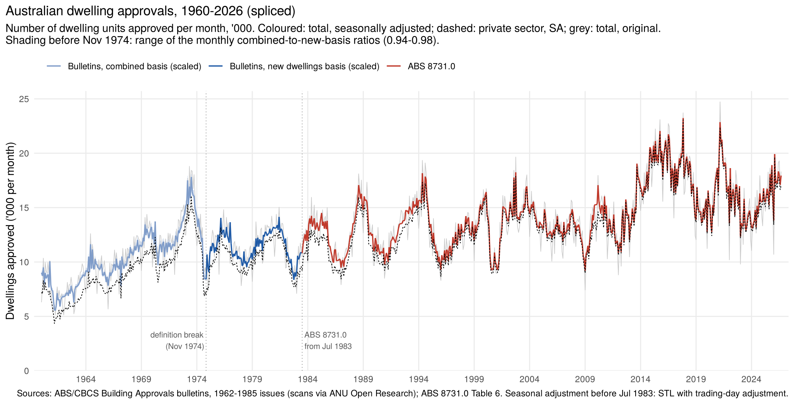
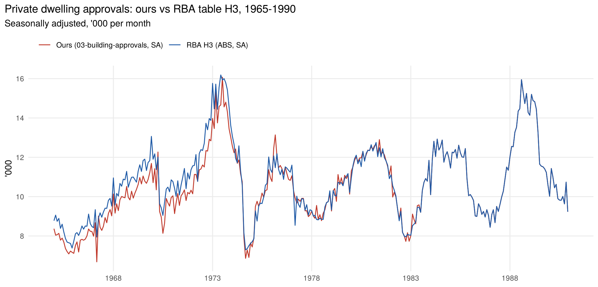

# Dwelling approvals, monthly, 1960 – 2026

Number of dwelling units approved, Australia, total and private sector, original and
seasonally adjusted. Built from the ABS/CBCS *Building Approvals, Australia* bulletins
(1962–1985 issues) and spliced onto ABS 8731.0 (Table 6) from July 1983.

## Definition break (1974–75)

Up to the mid-1975 issues the bulletins count "new houses and flats", which include
dwelling units created by alterations and additions and those in non-residential
buildings (the **combined** basis). From the December 1975 issue the series is new
dwellings in new residential buildings only (the **new** basis), revised back to 1973-74.
Both were printed monthly for November 1974 – June 1975.

## Method (`R/building_approvals_splice.R`)

1. For each month, keep the latest issue that printed it, separately for each basis.
2. **Link 1, combined → new basis:** geometric mean of the monthly ratios over
   Nov 1974 – Jun 1975: **0.950** for total (range 0.938–0.981), 0.931 for private.
   Annual cross-check: FY1974-75 printed on both bases gives 0.952.
3. **Link 2, bulletins → ABS 8731.0:** geometric mean over Jul 1983 – Dec 1985
   (30 months): **1.0074** for total (range 1.000–1.015).
4. **Seasonal adjustment:** ABS published SA from Jul 1983. Before that, STL on logs
   (robust, seasonal window 7) with a trading-day adjustment (each extra weekday in a
   month adds about 3.5% to approvals). The two meet within 0.3% at July 1983; STL
   differs from the SA figures printed in the bulletins (1966–83) by 2.8% on average.

## Files

| File | What it is |
|---|---|
| `data-raw/ba_raw.tsv` | Dec 1962, 1965, 1966 issues: private, government and total, Jan 1960 – Dec 1966 (wide, with printed year totals) |
| `data-raw/ba_long.tsv` | Jun 1967 – Dec 1985 issues: one row per issue × month, private and total, original and SA as printed; `basis` = combined/new; `note` = `thousands_1dp` where the issue printed '000 to one decimal (Dec 1976, Dec 1977 issues) |
| `data-raw/abs_dwellings_approved.tsv` | ABS 8731.0 Table 6, Australia, Jul 1983 – Sep 2026 |
| `data-raw/rba_h3_private_approvals_sa.tsv` | RBA table H3: private dwelling approvals, SA, Jan 1965 – Dec 1990 (for the cross-check) |
| `tools/check_ba_raw.py` | sum and cross-issue checks for `ba_raw.tsv` (all pass) |
| `output/dwelling_approvals_spliced_monthly.csv` | the spliced monthly series with source issue/page, SA method and band |
| `output/dwelling_approvals_splice_check.png` | the three sources over their overlaps |

## Checks

- Every bulletin table was checked with private + public = total (and houses + other =
  total where printed); all rows add up.
- Bulletin totals for 1974-75 printed on both bases match the splice to within 0.2%.

## Caveats

- The 0.950 factor drifts: FY1973-74 printed figures imply about 0.975, so the early
  1970s may be understated by about 2.5%. The band shows the 0.94–0.98 range.
- Oct 1975 – Oct 1977 are rounded to the nearest 100.
- 1960–66 "new houses and flats" are assumed to be on the combined basis; the bulletins
  are consistent with each other where they overlap.
- Sharp one-month spikes in the 1960s (e.g. June 1964, a large month of public housing)
  are as printed, not transcription errors.

## Cross-check against RBA table H3

The RBA's statistical table H3 carries the ABS's seasonally adjusted private dwelling
approvals back to January 1965 (series GISPSDA). `R/check_vs_rba_h3.R` compares it with our
private series; results are in `check_vs_rba/`.

| Period | Ours / RBA H3 (annual) | Note |
|---|---|---|
| 1975 – Jun 1983 (bulletins, new-dwellings basis) | 0.996 – 1.010 | Independent sources agree within 1% a year |
| Jul 1983 – 1990 (ABS 8731.0) | 1.000 | Same source |
| 1965 – Oct 1974 | 0.93 | H3 is **not** adjusted for the 1974-75 definition change |

Before November 1974 the H3 series stays on the old, broader definition (it includes
dwellings created by alterations and additions), so it steps down by about 7% when the
definition changes. Removing our 0.931 private-sector adjustment, our pre-1974 figures are
within 0.5% of H3 on average (ratio 1.005), which confirms the transcriptions; the 7% gap is
the definition adjustment, not a data difference.

