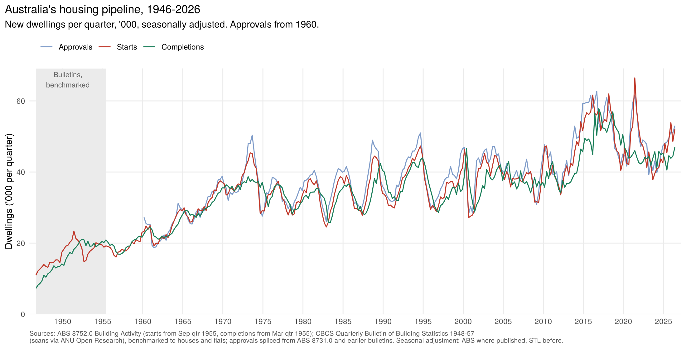

# Housing pipeline: starts and completions, quarterly, 1946 – 2026

New dwellings commenced (starts) and completed, Australia, from the September quarter
1946, charted with the dwelling approvals series from
[`03-building-approvals`](../03-building-approvals).

## Sources

- **From 1955: ABS 8752.0 Building Activity** (June 2026 release), Tables 33 and 37,
  new houses + new other residential, total and private sector. Starts from Sep qtr
  1955, completions from Mar qtr 1955. Used unchanged.
- **1946 – 1955: CBCS *Quarterly Bulletin of Building Statistics*** (December issues
  1948–1957, ANU scans).

## Method (`R/housing_pipeline.R`)

1. **Indicator:** until the December 1955 issue the bulletins count new **houses only**.
   For each quarter, keep the latest issue that printed it. Within every issue the
   quarters add up exactly to the printed year totals.
2. **Benchmark to houses and flats:** the December 1957 issue gives calendar-year
   totals of houses *and* flats, 1948–1957, on the basis the ABS still uses (its
   1956–57 quarters match ABS 8752.0 to within a few dwellings; 1955 completions match
   exactly). The houses-only quarters are scaled with proportional Denton benchmarking
   so they add up to those totals while the scaling ratio moves smoothly between
   quarters (flats added about 2–4%). For starts the 1955 benchmark is split: Mar + Jun
   qtr 1955 = the calendar total less ABS Sep and Dec qtr 1955. Sep 1946 – Dec 1947 have
   no benchmark and carry the 1948 ratio.
3. **Seasonal adjustment:** ABS published SA where available (starts from 1969,
   completions from 1984), STL before. They differ by under 1% on average over the
   first three years of overlap.
4. Approvals are summed from the monthly series to quarters.

## Files

| File | What it is |
|---|---|
| `data-raw/abs_starts_completions.tsv` | ABS 8752.0 starts and completions, total and private, original and SA |
| `data-raw/qb_raw.tsv` | bulletin transcriptions: one row per issue × period (Q, FY or CY) with starts, completions, under construction (where read) and notes on coverage |
| `output/housing_pipeline_quarterly.csv` | approvals, starts and completions per quarter, original and SA, with sources and benchmark ratios |
| `output/housing_pipeline_annual.png` | calendar-year totals |

## Caveats

- Totals only before 1955 (no private/public split transcribed).
- Northern Territory included from the Mar qtr 1955 (tiny).
- Dwellings under construction are printed in the bulletins and in ABS 8752.0 but are
  not built into a series here.
