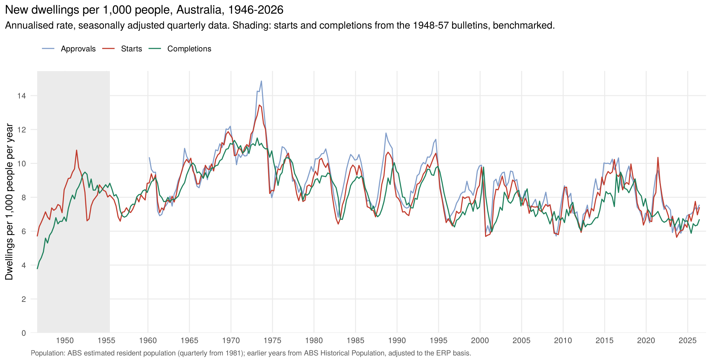

# Population and housing per capita, quarterly, 1946 – 2026

Quarterly population for Australia (total, aged 15–64 and aged 15+) and the housing
pipeline from [`04-housing-pipeline`](../04-housing-pipeline) expressed per 1,000 people.

## Population (`R/per_capita.R`)

- **From June 1981:** ABS 3101.0 quarterly estimated resident population (ERP).
- **1946 – 1981:** ABS *Historical Population* (2021) June and December totals; March
  and September interpolated geometrically.
- **Ages 15–64 and 15+:** June shares from the ABS age tables (five-year groups to 1970,
  ERP by single year of age from 1971), interpolated between Junes and applied to the
  quarterly total.
- **June 2026:** not yet published; extended at the March 2026 quarter's growth rate.

### Breaks in the official population series

| Year | Break | Adjustment |
|---|---|---|
| 1971 | Switch from people present in Australia to ERP (adds residents temporarily overseas and an allowance for census undercount). Official growth 1970–71 is 4.5% instead of about 2%. | Earlier years scaled up by **2.53%**, the amount that makes 1970–71 growth equal the average of the years either side. |
| 1961 | Totals start including estimates of the Aboriginal and Torres Strait Islander population (the age table includes them from 1966). | Earlier years scaled up by **0.38%**, the June 1961 ratio of the two series. |

The working-age share moves only 0.15 percentage points across the 1971 break.

## Per capita measures

Dwellings per 1,000 people, annualised: seasonally adjusted quarterly count × 4 /
end-of-quarter population × 1,000. Also per 1,000 aged 15–64 and per 1,000 aged 15+.

| Period | Completions per 1,000 people |
|---|---|
| 1950s | 8.2 |
| 1960s | 9.2 |
| 1970s | 10.1 |
| 1980s | 8.5 |
| 1990s | 8.0 |
| 2000s | 7.4 |
| 2010s | 7.6 |
| 2020–25 | 6.7 |

## Sources

Links to every source used here (bulletin scans, RBA, ABS and FRED tables) are in [`SOURCES.md`](../SOURCES.md).

## Files

| File | What it is |
|---|---|
| `data-raw/pop_erp_quarterly.tsv` | ABS 3101.0 Table 4, ERP Australia, quarterly Jun 1981 – Mar 2026 |
| `data-raw/pop_hist_total_halfyear.tsv` | Historical Population, Australia, 30 June and 31 December, 1944–1982 |
| `data-raw/pop_hist_age_june.tsv` | total, 15–64 and 15+ at 30 June, 1944–2025, with source |
| `output/population_quarterly.csv` | quarterly population: total, 15–64, 15+, shares and source |
| `output/housing_pipeline_per_capita.csv` | approvals, starts and completions per 1,000 people, per 1,000 aged 15–64 and per 1,000 aged 15+ |
| `output/starts_per_capita_denominators.png` | starts against the three population measures |

## Caveats

Households, not people, are the natural denominator for housing, but there is no
quarterly household series going back this far.
