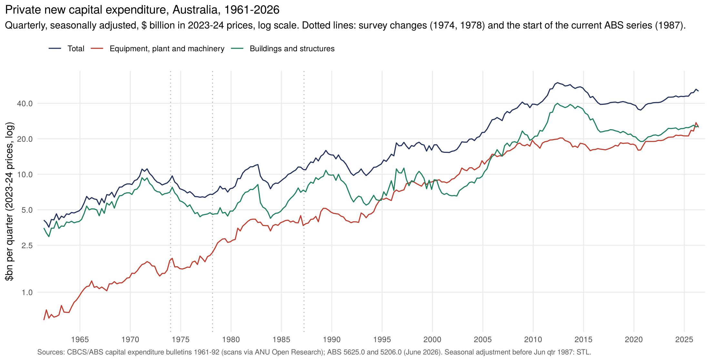
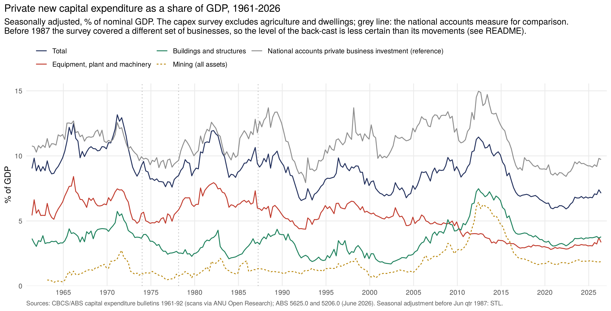
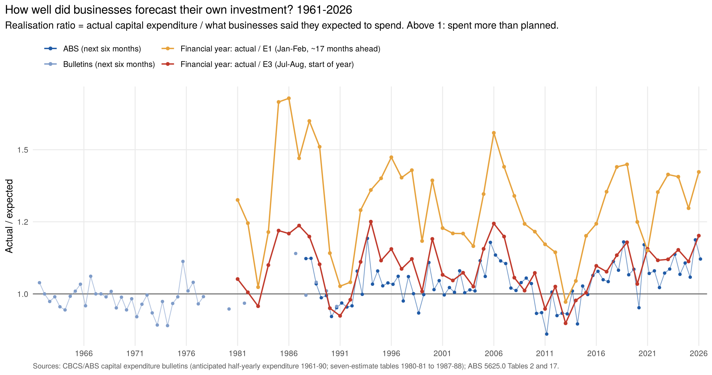

# Private new capital expenditure and investment expectations, 1961 – 2026

Quarterly private new capital expenditure ("capex"), Australia, from the June quarter
1961, by asset (buildings and structures; equipment, plant and machinery) and for mining
and manufacturing. It is built from the CBCS/ABS capex survey bulletins (1961–1992, ANU
scans) and joined onto the current ABS series (5625.0) from June 1987. The same bulletins
also record what businesses *expected* to spend, so there is a 65-year record of how
investment plans compare with what was actually spent.

## Sources

| Period | Source | Coverage |
|---|---|---|
| Jun qtr 1961 – Sep qtr 1974 | *Capital Expenditure by Private Businesses in Australia* (pounds to Jun 1965, converted at $2 = £1) | Private businesses subject to pay-roll tax, excluding rural industries (about 77–79% of the business field) |
| Dec qtr 1973 – Sep qtr 1978 | *New Capital Expenditure by Private Enterprises* (integrated series) | Integrated with the economic censuses; excludes community services |
| Mar qtr 1978 – Mar qtr 1992 | *New Fixed Capital Expenditure by Private Enterprises in Selected Industries* / *Private New Capital Expenditure* | Selected industries (excludes agriculture, construction, community services) |
| Jun qtr 1987 – Jun qtr 2026 | ABS 5625.0, June 2026 release | Current ABS scope, including education and health |

Bulletin issues transcribed: Sep qtr 1961, 1965, 1967, 1969, 1971, 1973, 1974, 1976, 1977,
1978, 1979, 1980; Jun qtr 1981; Dec qtr 1982 and 1984; Jun qtr 1986–1990; Mar qtr 1992,
plus the Jun 1965, 1969, 1972, 1974, 1975 and 1977 issues for expectations. Each issue
prints two to three years of quarters, so every quarter has at least one source and most
have two. Checks:

- Buildings + equipment = total, and manufacturing + non-manufacturing = total, in every
  row (to rounding).
- Quarterly figures add up exactly to the half-year and financial-year totals printed in
  other issues (e.g. 1964-65: £719.1m).
- Where an issue was later revised, the latest issue is used (32 quarters were revised).

## Method (`R/capex_splice.R`)

1. **Links between the four sources.** For each link, the ratio of the newer to the older
   source over the quarters where both exist (original figures, same quarters), averaged
   geometrically, separately for total, buildings, equipment, mining and manufacturing:

   | Link | Overlap | Total | Buildings | Equipment |
   |---|---|---|---|---|
   | pay-roll-tax → integrated | Dec 1973 – Sep 1974 (4 qtrs) | 1.28 | 1.25 | 1.31 |
   | integrated → selected industries | Mar – Sep 1978 (3 qtrs) | 1.00 | 1.01 | 1.00 |
   | selected industries → ABS 5625.0 | Jun 1987 – Mar 1992 (20 qtrs) | 1.28 | 1.38 | 1.23 |

2. **Seasonal adjustment.** ABS published seasonally adjusted series from June 1987;
   before that, STL on logs (robust, seasonal window 7). The STL quarterly growth rates
   track the seasonally adjusted figures printed in the bulletins (correlation 0.69, mean
   absolute difference 2.7 percentage points over 50 quarters, 1965–80). The two meet
   exactly at June 1987.
3. **Real terms.** Buildings deflated by the national accounts deflator for private
   non-dwelling construction, equipment by the machinery and equipment deflator
   (ABS 5206.0, 2023-24 prices). Total = buildings + equipment.
4. **Share of GDP** against nominal GDP (ABS 5206.0).

## Investment expectations

The survey has asked businesses what they plan to spend since 1961. Three measures are
assembled; the *realisation ratio* is actual spending divided by what was expected.

- **Next six months, 1961–2026.** What businesses said, at the start of each half-year,
  they expected to spend in it. Bulletins 1961–1990 (as anticipated % changes to 1969, then
  levels); ABS 5625.0 Table 2 from 1987 (expectations reported in June and December
  surveys). Where they overlap (1987–90) the two give similar ratios.
- **Financial year, seven estimates, 1980-81 to 2026-27.** The ABS's familiar structure
  (E1 = expectation reported in Jan–Feb of the previous financial year, ... E3 = Jul–Aug,
  ... E7 = actual) was already printed in the 1986 and 1990 bulletins, which take it back to
  1980-81. Where bulletin and ABS overlap (1988-89, 1989-90) their ratios agree to within
  0.05.

| Period | Half-year actual / expected (mean) | Range |
|---|---|---|
| 1961–69 | 0.99 | 0.94–1.06 |
| 1970–79 | 0.97 | 0.89–1.11 |
| 1980–90 | 1.01 | 0.92–1.14 |
| 1991–2000 | 1.03 | 0.93–1.19 |
| 2001–10 | 1.04 | 0.93–1.18 |
| 2011–26 | 1.05 | 0.86–1.19 |

Financial year: actual / E3 averages 1.09 (range 0.90–1.25); actual / E1 averages 1.31.
On the latest E3 for 2026-27 ($200.7bn) and the five-year average ratio (1.14), spending
in 2026-27 would be about $229bn, 9% above 2025-26.

## Files

| File | What it is |
|---|---|
| `data-raw/cx_raw.tsv` | Bulletin quarterly actuals: one row per issue × quarter, with basis, unit and notes |
| `data-raw/sa_printed.tsv` | Seasonally adjusted totals printed in the bulletins |
| `data-raw/cx_anticipated_pct.tsv` | Anticipated vs actual half-yearly % changes, 1961–69 |
| `data-raw/cx_half_antic.tsv` | Anticipated and actual half-year levels, 1969–77 |
| `data-raw/cx_expect_raw.tsv` | Other printed expectations (next quarter / next six months), 1965–90 |
| `data-raw/cx_fy_expect_raw.tsv` | The seven-estimate financial-year table from the 1986, 1990 and 1992 bulletins |
| `data-raw/abs_capex_quarterly.csv` | ABS 5625.0: original by asset and industry, SA totals, Jun 1987 – Jun 2026 |
| `data-raw/abs_capex_fy_expectations.csv` | ABS 5625.0 Table 17: E1–E7 for 1987-88 to 2026-27 |
| `data-raw/abs_short_term_expected_half.tsv` | ABS 5625.0 Table 2: next-six-months expectations |
| `data-raw/abs_gdp_ipd_quarterly.tsv` | ABS 5206.0: nominal GDP (SA) and investment deflators |
| `data-raw/abs_na_business_investment.tsv` | ABS 5206.0: private non-dwelling construction and machinery & equipment, current prices, SA (coverage check) |
| `output/capex_spliced_quarterly.csv` | The spliced series: original, SA, real, % of GDP, source and SA method |
| `output/capex_realisation_ratios.csv` | Half-year expected vs actual, 1961–2026 |
| `output/capex_fy_expectations.csv` | Financial-year E1–E7 and realisation ratios, 1980-81 to 2026-27 |
| `output/capex_splice_check.png` | The four sources over their overlaps |

## Caveats

- **Levels before 1987 are less certain than movements.** The links assume each survey's
  coverage was a constant share of the next one's. Compared with the national accounts,
  the spliced series is about 0.9 of private business investment before 1987 but 0.72–0.77
  since, so the back-cast level (and so its share of GDP) is probably 10–20% too high.
  The high early-1970s share of GDP should be read with that in mind; the national
  accounts line on the chart is the safer guide to levels. Growth rates, cycles and the
  asset and industry mix are unaffected.
- The 1973-74 link rests on four quarters and shifts the whole pre-1974 series by 28%.
- Real equipment spending looks very small in the 1960s because machinery prices have
  risen far less than construction prices since then (the national accounts deflators);
  adding the two deflated components is an approximation.
- Mining is not shown separately before March 1963.
- Expectations: the 1961–69 half-year ratios come from whole-percentage changes, so each is
  accurate to about ±1%. Bulletin expectations before 1987 cover the bulletin's own scope,
  but ratios are scale-free so they compare across sources.
