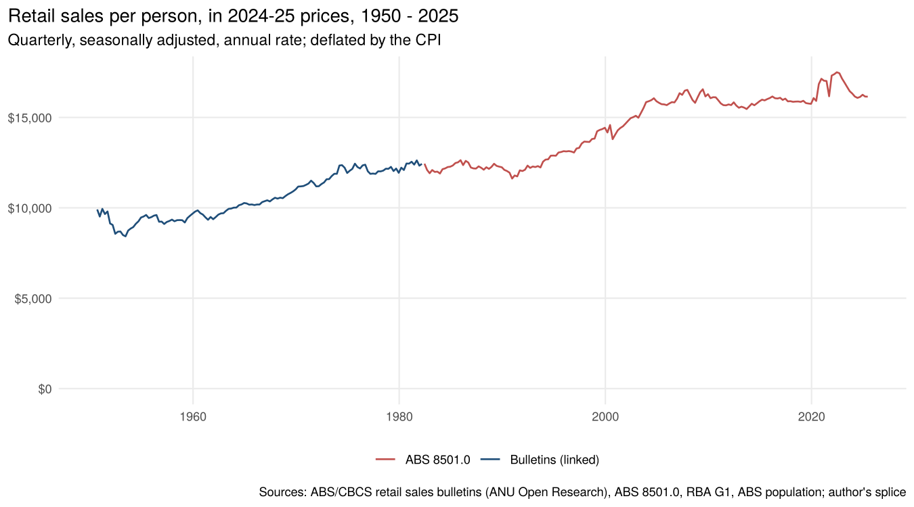
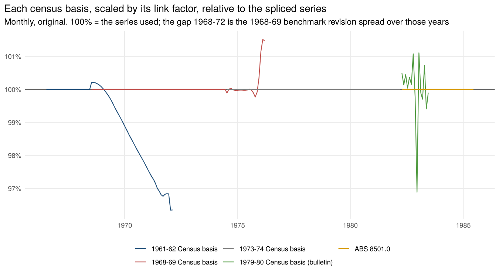
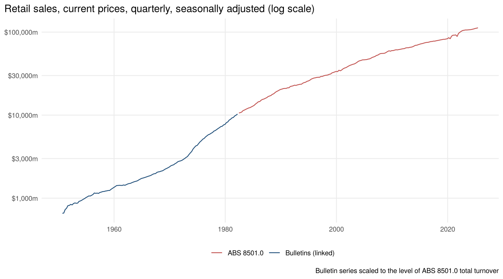

# Retail sales, 1947-48 to 2025

Retail turnover in Australia, current prices, original and seasonally adjusted:

- **monthly** from July 1961
- **quarterly** from the September quarter 1950
- **financial years** from 1947-48

It also gives real retail sales (in 2024-25 prices) and real retail sales per person.

It is built from the CBCS/ABS *Retail Sales of Goods* bulletins (1952–1983, ANU scans) and the
*Quarterly Summary of Australian Statistics*. These are joined onto ABS 8501.0 *Retail Trade,
Australia* (April 1982 to June 2025, its final release).

## Sources

| Period | Source | Census benchmark |
|---|---|---|
| 1947-48 to 1955-56 (years) | *Quarterly Summary of Australian Statistics* No. 238 (Dec 1959), No. 254 (Dec 1964) | 1956-57, then 1961-62 |
| Sep qtr 1950 – Dec qtr 1953 | *Retail Sales of Goods*, Sep and Dec qtr 1953 bulletins | earlier censuses (benchmarked here to the annual totals) |
| Sep qtr 1956 – Dec qtr 1959 | QSAS No. 238; *Retail Sales of Goods*, Sep qtr 1959 | 1956-57 |
| Sep qtr 1958 – Jun 1972 | *Retail Sales of Goods*, Jun qtr 1965, Dec qtr 1967, Dec qtr 1971, Dec qtr 1973 | 1961-62 |
| Jul 1971 – Apr 1976 | *Retail Sales of Goods*, Dec qtr 1973, 1975, 1977 | 1968-69 |
| Sep qtr 1974 – Apr 1982 | *Retail Sales of Goods*, Dec qtr 1977–1980, Mar qtr 1982 (cat. 8503.0); May 1982 | 1973-74 |
| Apr 1982 – Jun 1983 | *Retail Sales of Goods (excluding motor vehicles ...)*, May 1982, Jun 1983 | 1979-80 |
| Apr 1982 – Jun 2025 | ABS 8501.0, Table 1 (total turnover; cafes, restaurants and takeaway) | current |

The bulletin series is *retail sales of goods, excluding motor vehicles, parts, petrol, etc.*,
for the six states. NT and ACT are excluded until 1982.

The surveys were re-based on each census of retail establishments: 1947-48, 1948-49, 1952-53,
1956-57, 1961-62, 1968-69, 1973-74 and 1979-80. Each re-basing gives a break in level.

Every value in `data-raw/rs_raw.tsv` records the issue and page it came from.
`tools/transcribe.py` holds the transcriptions and checks them:

- months add up to the printed quarters;
- months and quarters add up to the printed financial years.

All checks pass. Where a period was printed more than once, the latest issue is used. These
bulletins revise heavily for "trading by new businesses". For example, 1971-72 went from
$10,367m to $10,772m between the Dec 1973 and Dec 1975 issues.

## Method (`R/retail_splice.R`)

1. **Latest revision within each census basis.** For each quarter, take the newer of:
   - the printed quarter;
   - the sum of the printed months.

   Where a financial-year total was printed later than its quarters, the quarters are
   benchmarked to it by proportional Denton. The months are then Denton-benchmarked to those
   quarters, so later revisions flow down to the monthly figures.
2. **Links between bases.** Each link uses the overlap the ABS itself published, on original
   (not seasonally adjusted) figures:

   | Link | Overlap | Ratio |
   |---|---|---|
   | 1979-80-basis bulletin → ABS 8501.0 total turnover | Apr 1982 – Jun 1983 (15 months) | 1.094 (range 1.08–1.13) |
   | 1973-74 → 1979-80 basis | Apr 1982, printed on both bases | 0.999 |
   | 1968-69 → 1973-74 basis | Sep and Dec qtr 1975, printed on both bases | 0.971 |
   | 1961-62 → 1968-69 basis | 1968-69 Census year (see below) | 1.041 |
   | 1956-57 → 1961-62 basis | Six financial years, 1952-53 and 1954-55 to 1958-59 | 0.927 (range 0.924–0.929) |

3. **The 1968-69 benchmark.** The two bases overlap from mid-1971. Over that overlap, the
   revised 1968-69-basis figures are 7.5% above the 1961-62-basis series. In the census year
   itself, 1968-69, the Census total was only 4.1% above it.

   So the old sample missed growth from new businesses between the two dates. The two are
   reconciled by benchmarking the 1961-62-basis quarters, Sep qtr 1968 to Sep qtr 1972, to two
   anchors:
   - the 1968-69 Census total;
   - the 1968-69-basis quarters from Sep qtr 1971.

   The 3.4% gap is then spread smoothly over 1968-69 to 1971-72, instead of putting it all in
   one month. The check chart shows this.
4. **Quarters before July 1961.**
   - Annual totals from the QSAS tables, all on the 1961-62 basis (earlier years linked by the
     0.927 ratio).
   - The quarterly pattern comes from:
     - the 1950–53 and 1956–59 bulletins;
     - the 1961-62-basis quarters from Sep qtr 1958.
   - Mar qtr 1954 – Jun qtr 1956 were not published. These ten quarters use the average seasonal
     pattern of 1950–53 and 1956–59, on a trend that matches the published annual totals.
5. **Seasonal adjustment.**
   - **From April 1982:** the ABS's seasonally adjusted series.
   - **July 1963 – March 1982:** the bulletins printed seasonally adjusted figures. The implied
     factors (original ÷ seasonally adjusted, same issue) are applied to the spliced series.
   - **July 1961 – June 1963:** no adjusted figures were printed. These months use a regression
     of the 1963–69 bulletin factors on calendar month and the number of each weekday in the
     month. It fits with R² 0.998 and a residual of 0.5%.
   - **Before September 1961:** STL on the quarterly series.

   Checks against other estimates:

   | Check | Result |
   |---|---|
   | STL on the monthly series, 1963–82 (quarterly sums) | Within 0.6% on average; quarterly growth correlation 0.81 |
   | Seam at April 1982 | +1.8%; the old series printed +1.6% for that month |
   | Seam at September 1961 | Within 0.5% |
6. **Real and per person.** Real values are deflated by the all-groups CPI (RBA table G1) and
   expressed in 2024-25 prices. Per person values use the quarterly population in
   [`05-housing-per-capita`](../05-housing-per-capita).

## Results

| Decade (years ended June) | Nominal growth, % a year | Real growth per person, % a year |
|---|---|---|
| 1951–1960 | 9.4 | 0.7 |
| 1961–1970 | 5.9 | 1.3 |
| 1971–1980 | 12.7 | 0.9 |
| 1981–1990 | 9.9 | 0.1 |
| 1991–2000 | 5.2 | 1.8 |
| 2001–2010 | 5.9 | 1.2 |
| 2011–2020 | 3.5 | −0.1 |
| 2021–2025 | 5.8 | 0.4 |

Real retail spending per person:

- **1950s:** roughly flat, after the Korean War boom and the 1952 credit squeeze;
- **1960s and early 1970s:** rose by about a quarter;
- **mid-1970s to early 1990s:** flat for nearly two decades;
- **1990s and early 2000s:** rose strongly;
- **since about 2004:** flat again, apart from the pandemic spike.

## Files

| File | What it is |
|---|---|
| `tools/transcribe.py` | All transcriptions, with sum checks; writes `data-raw/rs_raw.tsv` |
| `data-raw/rs_raw.tsv` | One row per issue × period × measure: issue, page, frequency, census basis, original/seasonally adjusted, £ or $ |
| `data-raw/abs_retail_8501.tsv` | ABS 8501.0 (June 2025), Table 1, Australia: total turnover original and SA, and cafes, restaurants and takeaway, Apr 1982 – Jun 2025 |
| `data-raw/rba_g1_cpi_quarterly.tsv` | RBA G1: CPI all groups, quarterly, 1946–2026 |
| `output/retail_sales_monthly.csv` | Jul 1961 – Jun 2025: original, SA, real SA, real per person (annualised), source and SA method |
| `output/retail_sales_quarterly.csv` | Sep qtr 1950 – Jun qtr 2025, same columns |
| `output/retail_sales_financial_year.csv` | 1947-48 to 2024-25: nominal, real, real per person, growth |
| `output/retail_splice_links.csv` | The link ratios above |

## Caveats

- **Scope.** The bulletin series covers retail sales of *goods*. The ABS total turnover also
  includes cafes, restaurants and takeaway food.
  - The link scales the old series to the ABS total in 1982–83. Before 1982, growth is that of
    goods retailing.
  - Against ABS turnover excluding cafes, restaurants and takeaway, the link would be 0.987
    instead of 1.094. Levels before 1982 would be 10% lower.
  - Growth rates are unaffected.
- **Census re-basings.** These change the level by up to about 7%. Each is handled with the ABS's
  own overlap, but each link carries some error. The 1956-57 → 1961-62 ratio is very stable
  (0.924–0.929).
- **Early years.**
  - Mar 1954 – Jun 1956 are interpolated within published annual totals.
  - 1947-48 to 1949-50 are annual only.
  - Figures before 1952-53 are census and survey figures that the ABS did not revise to later
    bases.
- **Seasonal adjustment.** The bulletin factors before 1982 are the ABS's of the day,
  including its trading-day adjustment. They are not re-estimated on the spliced series.
- **Real values.** The all-groups CPI includes services and housing, so it is only an
  approximate retail deflator. The CPI is quarterly, rounded to two decimals on a 2025 base,
  and interpolated for months.
- **End of the series.** ABS 8501.0 ceased after June 2025. This series stops there.
