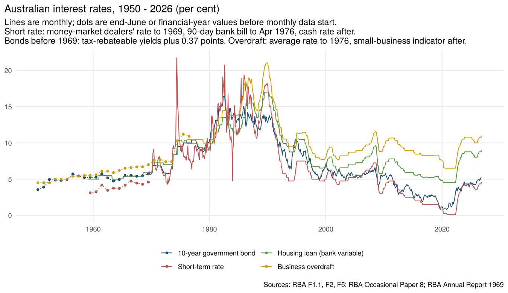
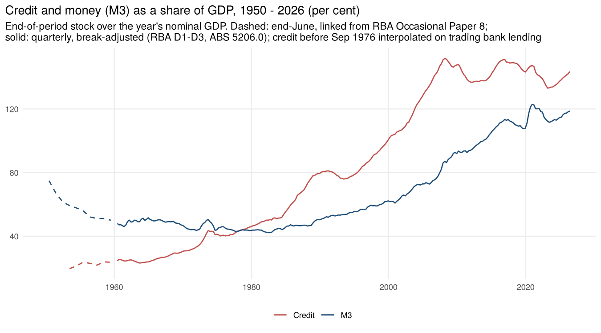
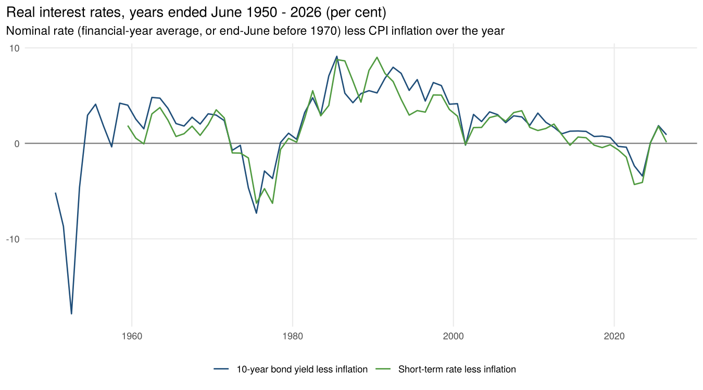
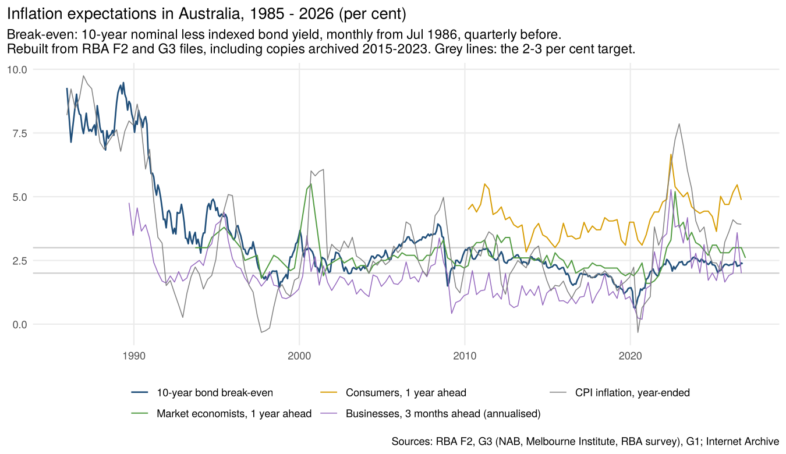
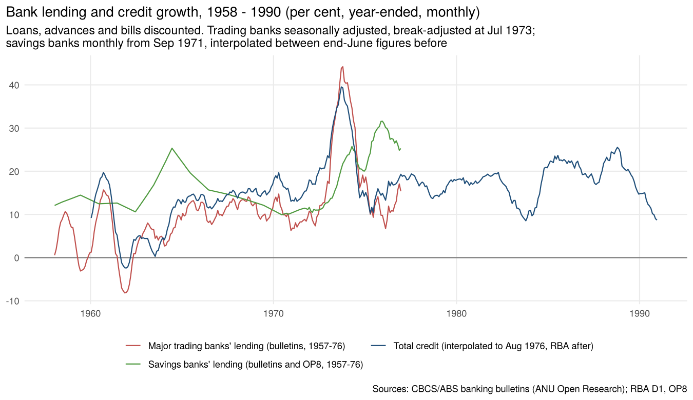
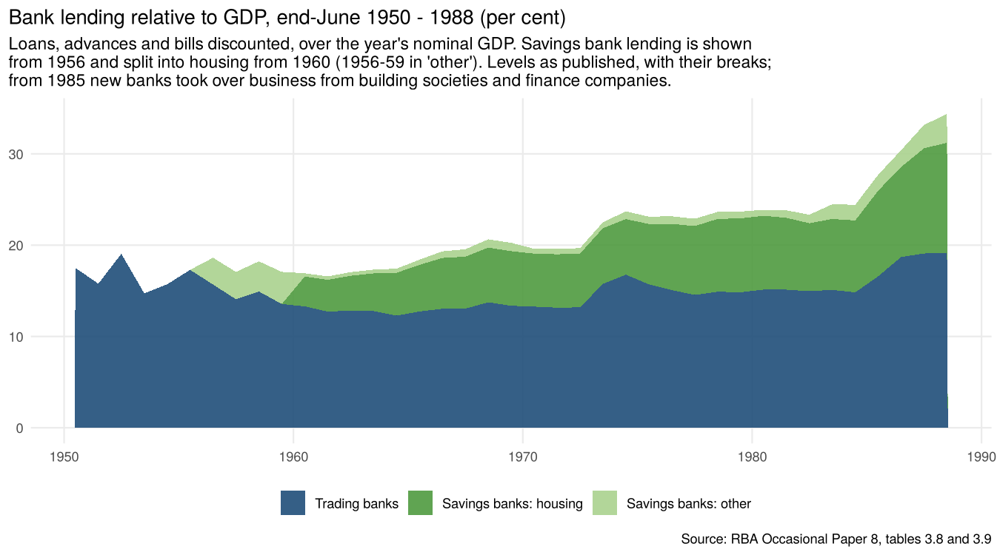

# Interest rates, money and credit, 1950 – 2026

Long-run Australian series in three parts:

- **interest rates:** short-term rate, 10-year government bond, housing and business lending;
- **money:** currency, M3 and broad money;
- **credit:** total, housing, personal and business;
- **inflation expectations:** 10-year break-even inflation from the bond market, and the survey measures.

Each comes in levels, growth and shares of GDP, and real rates are also given.

- **Monthly:** interest rates from 1959 (housing) and 1969 (bills and bonds); money and credit from 1959;
  trading and savings bank lending 1957–1976, transcribed from the CBCS/ABS banking bulletins; break-even
  inflation from 1986 (quarterly from Dec 1985).
- **Annual (years ended June):** everything back to 1950. These come from the RBA's
  *Australian Economic Statistics 1949–50 to 1996–97* (Occasional Paper No. 8) and the 1969
  Annual Report, linked to the monthly series.

## Sources

| Source | Series | Period |
|---|---|---|
| RBA F1.1 | Cash rate target (from Aug 1990), interbank overnight cash rate (from May 1976), 90-day bank bills (from Jun 1969); monthly averages | 1969 – Oct 2026 |
| RBA F2 (historical file and current) | 10-year Australian Government bond yield | Jul 1969 – Oct 2026 |
| RBA F5 | Banks' standard variable housing rate (from 1959), small business variable overdraft indicator rate (from 1976), large business weighted average (1978–2019) | 1959 – Oct 2026 |
| RBA D3 | Currency, M3 (levels, seasonally adjusted from 1965), broad money | Jul 1959 – Sep 2026 |
| RBA D1, D2 | Credit and money growth rates (break-adjusted), and the latest levels | Sep 1976 – Sep 2026 |
| RBA Occasional Paper 8, tables 3.1, 3.2, 3.21a, 3.22a, 3.22b, 3.23 | M3 (from 1950), total credit (from 1953), bond yields, Treasury notes, money-market dealers' rate, bank bills, overdraft rates | 1949-50 – 1996-97 |
| RBA Annual Report 1969, *Australian Interest Rates and Security Yields* | 10-year bond yields on rebateable and non-rebateable bonds, end of quarter | Sep 1966 – Jun 1969 |
| CBCS/ABS banking bulletins (ANU Open Research scans): *Australian Banking Statistics* monthly bulletin, *Banking Statistics*, *Banking*, and the major trading banks' preliminary statements | Major trading banks' loans, advances and bills discounted, monthly average of weekly figures, original and seasonally adjusted | Jan 1957 – Dec 1976 (plus Decembers 1947–56) |
| The same bulletins: *Banking Statistics* (Oct 1971 – Oct 1974) and *Banking* (Dec 1975, Dec 1976), savings bank assets tables | Savings banks' loans, advances and bills discounted, housing and other, end of month | Sep – Oct 1970, Sep 1971 – Dec 1976 |
| RBA Occasional Paper 8, tables 3.8 and 3.9 | Trading banks' loans, advances and bills discounted (June average of weekly figures); savings banks' loans, total and housing (end-June) | 1950 – 1989 (savings bank loans from 1956, housing from 1960) |
| RBA D2 | Lending by all banks (DLCALAB), for comparison | Sep 1976 – Dec 1978 |
| RBA F2 historical file (`f02histhist.xls`) | 10-year nominal and indexed bond yields, monthly | Jul 1986 – May 2013 |
| RBA F2 current file (`f02hist.xlsx`), and a copy of `f02hist.xls` from 14 Nov 2016 (Internet Archive) | The same; the archived copy fills Jun 2013 – Oct 2014, which the current file lacks, and overlaps the new indexed series | Jun 2013 – Oct 2026 |
| RBA G3, current file and 17 copies of `g03hist.xls` from 2015–2023 (Internet Archive) | Break-even 10-year inflation (quarterly); consumer (Melbourne Institute), business (NAB), market economist and union official expectations | Dec 1985 – 2026 |
| RBA G1; ABS 5206.0 | CPI; nominal GDP (quarterly, from Sep 1959) | |

The RBA tables were read in the browser and saved to `data-raw/rba_monthly.csv`, with the
latest credit levels in `data-raw/rba_credit_anchors.csv`. The Occasional Paper 8 and 1969
Annual Report figures are in the other `data-raw` files.

## Method (`R/money_credit_rates.R`)

1. **Short-term rate.** The series is joined from three rates, all published by the RBA:

   | Period | Rate | Frequency |
   |---|---|---|
   | 1959-60 – 1968-69 | Official money-market dealers' weighted average rate | End-June |
   | Jun 1969 – Apr 1976 | 90-day bank bill rate | Monthly |
   | From May 1976 | Cash rate (interbank overnight, then the target from 1990) | Monthly |

   November 1969's bill rate is recorded as 0 in the RBA table and is treated as missing.
2. **10-year bond yield.**
   - **From July 1969:** RBA monthly.
   - **1949-50 to 1968-69:** end-June yields from Occasional Paper 8. These are for tax-rebateable
     bonds. From late 1968 the Commonwealth issued non-rebateable bonds, which yielded
     0.35–0.39 points more. The three quarters printed on both bases (Dec 1968 – Jun 1969,
     1969 Annual Report) average **0.37 points**, which is added to the earlier yields.
   - **Check:** Occasional Paper 8's financial-year averages from 1969-70 match the RBA monthly
     series to within 0.17 points.
3. **Money and credit: breaks.** The RBA's levels contain breaks, such as new reporting
   institutions and reclassifications. Its growth rates (table D1) are adjusted for them. So the
   levels are rebuilt by chaining the monthly growth rates back from the latest published level:
   - **Total credit:** the series excluding financial businesses (current definition) from May
     2003, and the older total credit series before.
   - **Housing credit:** owner-occupier plus investor.
   - **Business and personal credit:** the same approach as total credit.
   - **Check:** the components add to the total within 0–2.5% from 2003.
4. **M3 before September 1976.** These are the RBA's levels. The new reporting from August 1976
   raised the level by 14.5% in one month, which D1 does not cover. The earlier levels are
   linked at July 1976, taking July–August growth as the average of the next six months
   (1.16% a month).
5. **Annual figures before the monthly series.**
   - **Method:** Occasional Paper 8's end-June growth rates (adjusted by the RBA for breaks) are
     chained back from the monthly levels: M3 before 1960 and credit before 1977.
   - **Credit's 1977 gap:** the paper gives no credit growth for 1976-77, because a new
     collection began in August 1976. June 1976 is estimated from September 1976 using the
     average growth of the following nine months.
   - **Checks against the paper:**

     | Measure | Years | Mean absolute difference |
     |---|---|---|
     | Credit growth | 1979–97 | 0.2 points |
     | M3 growth | 1961–92 | 0.9 points |
6. **Monthly bank lending and credit before September 1976.**
   - **Bank lending.** Major trading banks' loans, advances and bills discounted, transcribed in
     `data-raw/anu_bank_loans_monthly.csv` with the issue and page of every value (740 values from
     50 issues). The main source is Table 23 of *Banking Statistics*, March 1975, which prints the
     whole series, original and seasonally adjusted, for Jan 1960 – Mar 1975. The other issues
     fill 1957–59 and Apr 1975 – Dec 1976. Where a month was printed more than once, the latest
     issue is used. Pre-1966 pounds are converted at $2 = £1.
   - **Checks.** 185 months were transcribed from two or more issues. All agree to within
     $1 million, apart from the definitional break below. Each later issue's levels also match its
     own printed month-to-month changes.
   - **Break in July 1973.** The series was redefined in July 1973. Jul–Oct 1973 were printed on
     both bases; the new basis is 1.35% lower, and earlier months are scaled down by that ratio.
   - **Seasonal adjustment.** The bulletins' own factors (X-11), taken as original ÷ seasonally
     adjusted from the same issue. 1957–59 use the 1960–64 average factor for each month.
   - **Savings bank lending.** Savings banks' loans, advances and bills discounted, split into
     housing and other, are transcribed in `data-raw/anu_savings_bank_loans_monthly.csv` for
     Sep 1971 – Dec 1976 (five issues of 14 months each) and Sep – Oct 1970. The bulletins before
     1971 print savings bank deposits but not their loans, so earlier months come from Occasional
     Paper 8's end-June figures (table 3.9: total loans from 1956, housing from 1960), interpolated
     log-linearly between Junes (and Sep – Oct 1970). All are put on the basis of the latest figures:

     | Break | Evidence | New ÷ old |
     |---|---|---|
     | Papua New Guinea excluded from 1974 | Sep – Oct 1973 printed on both bases | housing 1.000, other 0.962 |
     | One savings bank's accounting changed, June 1975 | Nov – Dec 1975 printed on both bases | housing 1.000, other 0.945 |
     | Loans to prescribed banks other than trading banks excluded from June 1970 | No overlap; OP8 says "about $150 million" with deposits | other loans before June 1970 × 0.55 (an estimate: 1969-70 growth set to the 1970-73 average) |

     The bulletins' June figures match OP8 to within $1 million (1972–74, 1976); June 1975 differs
     by the accounting change. Savings bank loans have little seasonality and are not adjusted.
   - **All banks.** Major trading banks plus savings banks. In Sep – Dec 1976 this is 99.4–99.7% of
     the RBA's lending by all banks (DLCALAB), against 61% for the major trading banks alone.
   - **Monthly total credit, Jun 1957 – Aug 1976.** The end-June totals from step 5, and Sep 1976
     from the RBA series, are interpolated by proportional Denton on seasonally adjusted lending by
     all banks. For stocks this moves the ratio of credit to bank lending in a straight line
     between benchmarks, so the monthly path follows the banks while every June matches.
   - **How close is the indicator?** Over the years to June 1958–1976, total credit grew 13.9% a
     year, all banks' lending 12.1% and the major trading banks' 10.6%, as finance companies and
     building societies gained share. The correlation with credit growth is 0.83 for all banks and
     0.89 for trading banks alone; savings bank lending before 1971 is interpolated between Junes,
     so it adds level rather than monthly timing.
7. **Break-even inflation and inflation expectations.**
   - **Why the history is patchy.** The RBA's current table G3 shows break-even inflation only from
     2015 and consumer expectations only from 2022, because it keeps a rolling window of the
     licensed Melbourne Institute series. F2's indexed bond yield is missing Jun 2013 – Oct 2014.
     Earlier copies of both files, saved by the Internet Archive, hold the rest. They are joined
     here, latest copy first, and `data-raw` records the file each value came from. The copies
     agree with each other and with the current files, apart from a 2016 revision of the
     break-even history (up to 0.09 points) and some market economist 2-year values.
   - **Break-even, quarterly, Dec 1985 – Sep 2026.** The RBA's own series (G3): the 10-year nominal
     yield less the 10-year indexed bond yield, in the last month of each quarter. One quarter
     (Jun 1986) is missing.
   - **Break-even, monthly, Jul 1986 – Oct 2026.** The same difference from the monthly F2 yields.
     F2's indexed series changed in Nov 2014: the old one is 0.3–0.5 points higher where they
     overlap, and the RBA revised its quarterly history to a consistent basis in 2016. So the
     monthly differences are benchmarked to the RBA's quarterly values: the gap at each
     quarter-end is interpolated across the months between, separately for the old and new
     indexed series. The gap averages 0.15 points on the old series and 0.04 on the new one.
   - **Before 1985** there is no market measure: the Commonwealth first issued indexed bonds in
     1985. The survey history before the 1990s (Melbourne Institute consumers from 1973; the
     employers' Survey of Industrial Trends from 1966) is not freely published.
8. **Shares of GDP.** Each stock at the end of the period is divided by nominal GDP over the
   four quarters to then.
   - **From 1959-60:** ABS 5206.0 GDP.
   - **Before that:** the GDP implied by the paper's own ratios, raised by 14.5%. That is the
     average gap between today's GDP estimates and the paper's 1990s vintage over 1960–1970.

   Today's GDP is higher, and today's credit definition is narrower. As a result, credit/GDP
   here runs about 7 points below the paper's published ratio in 1978–97, but on a consistent
   basis.
9. **Real rates.** Nominal rate (financial-year average, or end-June where only that exists)
   less CPI inflation over the year (RBA G1).

## Results

| Years ended June | Short rate | 10-year bond | CPI inflation | Real short rate | Real bond | M3 growth | Credit growth |
|---|---|---|---|---|---|---|---|
| 1951–1960 | 3.2* | 5.0 | 6.2 | 1.2* | −1.2 | 5.9 | 11.5 |
| 1961–1970 | 4.4 | 5.4 | 2.5 | 1.9 | 2.9 | 7.7 | 10.9 |
| 1971–1980 | 8.4 | 8.6 | 10.2 | −1.8 | −1.6 | 13.6 | 18.9 |
| 1981–1990 | 14.3 | 13.6 | 8.3 | 6.0 | 5.3 | 13.4 | 18.0 |
| 1991–2000 | 6.7 | 8.2 | 2.2 | 4.5 | 5.9 | 7.1 | 7.8 |
| 2001–2010 | 5.2 | 5.6 | 3.2 | 2.1 | 2.4 | 11.5 | 10.9 |
| 2011–2020 | 2.4 | 3.1 | 2.0 | 0.4 | 1.0 | 6.8 | 4.3 |
| 2021–2026 | 2.6 | 3.3 | 3.9 | −1.3 | −0.6 | 6.9 | 6.4 |

\* 1959-60 only. Averages of annual values, per cent.

**Credit/GDP:**

| Period | Credit, % of GDP |
|---|---|
| 1950s | About 20% |
| 1977 | 41% |
| 1990 | 81% |
| 2000 | 103% |
| Peak, March 2008 | 152% |
| June 2026 | 144% |

Housing credit made up most of the rise, from 15% of GDP in 1977 to 89% now.

**M3/GDP:**

| Period | M3, % of GDP |
|---|---|
| 1950 (wool-boom deposits) | 75% |
| 1960s–1980s | Flat at 40–50% |
| June 2026 | 119% |

**Break-even inflation:**

| Period | Average | Range |
|---|---|---|
| Jul 1986 – 1989 | 8.1% | 6.8 – 9.5% (peak May 1989) |
| 1990 – 1993 | 5.1% | 3.1 – 8.4% |
| 1994 – Oct 2026 (inflation targeting) | 2.5% | 0.6 – 4.9% |
| 2020 | 1.2% | low of 0.6% in April 2020 |

Over the years to June 1987–2026 break-even inflation averaged 3.3%, against CPI inflation of
3.2%. So the ex-ante real 10-year yield (nominal less break-even) and the ex-post real yield
(nominal less actual inflation) both average 2.8%.

Trading bank lending shows the policy cycles of the period: the 1960–61 credit squeeze (lending
fell 8% in the year to November 1961), growth of 3–15% a year from 1964 to 1970, the 1973 boom
(44% in the year to October 1973) and the 1974 squeeze, after which growth slowed to 7% by early
1976. Savings bank lending, almost all housing, moved differently: it grew 10–25% a year through the
1960s without the trading banks' swings, and accelerated to about 30% in 1975–76, when trading
bank lending was slowing.

**Savings banks' share of bank lending** (end-June, levels as published):

| June | Trading banks, $m | Savings banks, $m | Savings banks' share | Savings bank housing, % of GDP | Banks' share of total credit |
|---|---|---|---|---|---|
| 1958 | 2,060 | 456 | 18% | n.a. | 76% |
| 1966 | 3,183 | 1,535 | 33% | 5.6% | 74% |
| 1974 | 10,120 | 4,186 | 29% | 6.1% | 55% |
| 1982 | 26,337 | 14,742 | 36% | 7.4% | 47% |
| 1986 | 48,847 | 30,575 | 38% | 9.9% | 48% |

From the late 1950s savings banks went from deposit-takers that held mostly government
securities to the main source of housing finance. Banks as a whole lost ground to finance
companies and building societies until deregulation in the mid-1980s.

## Files

| File | What it is |
|---|---|
| `output/interest_rates_monthly.csv` | Jan 1959 – Oct 2026: cash rate, 90-day bill, 10-year bond, housing variable, small business overdraft, large business average, the joined short rate and its source, CPI inflation, real short rate and real bond yield |
| `output/money_credit_monthly.csv` | Jul 1959 – Sep 2026, $ billion: currency, M3, broad money (from 1976), and break-adjusted credit (total, housing, personal, business, from Aug 1976) |
| `output/money_credit_pct_gdp_quarterly.csv` | Credit (total, housing, business), M3 and broad money as % of GDP, quarterly |
| `output/long_run_annual.csv` | Years ended June 1950 – 2026: rates (with the basis of each value), inflation, real rates, break-even inflation and the ex-ante real bond yield (from 1987), M3 and credit growth, levels and % of GDP, nominal GDP |
| `output/bond_10y_quarterly_1966_69.csv` | The 1969 Annual Report's rebateable and non-rebateable 10-year yields |
| `output/breakeven_inflation_monthly.csv` | Dec 1985 – Oct 2026: 10-year nominal and indexed yields (and which indexed series), their difference, the RBA quarterly break-even, the benchmarked monthly break-even and the implied real yield |
| `output/inflation_expectations_quarterly.csv` | Dec 1985 – Dec 2026: break-even, real 10-year yield, consumer (1 year), business (3 months, annualised), market economists (1 and 2 years), union officials (1 and 2 years), CPI inflation |
| `output/bank_lending_monthly_1957_76.csv` | Jan 1957 – Dec 1976, $ million: major trading banks' lending (break-adjusted, original and seasonally adjusted, and as printed, with the source issue); savings banks' housing, other and total lending (break-adjusted, with method and source); all banks' lending (original and SA); and the interpolated monthly total credit |
| `output/bank_lending_june_1950_89.csv` | End-June 1950 – 1989: trading and savings bank lending as published, savings banks' share, shares of GDP, banks' share of total credit, the break-adjusted savings bank figures, and OP8's notes on breaks |
| `data-raw/rba_f2_indexed_bond_monthly.csv` | 10-year nominal yield and the old and new indexed bond yield series, monthly, with the file each came from |
| `data-raw/rba_g3_inflation_expectations.csv` | Every G3 series by quarter, with the file (current or archived copy) each value came from |
| `data-raw/anu_bank_loans_monthly.csv` | Every transcribed bank lending value: series, month, value, unit (£'000, £m or $m), issue, page, note |
| `data-raw/anu_savings_bank_loans_monthly.csv` | Every transcribed savings bank loans value (housing, other): month, value, issue, page, note |
| `data-raw/op8_3_8_trading_banks_june.csv`, `op8_3_9_savings_banks_june.csv` | OP8 tables 3.8 and 3.9 (deposits and loans at June), with the tables' notes on breaks |
| `data-raw/` (other) | The RBA extract, the Occasional Paper 8 tables and the 1969 Annual Report figures |

## Caveats

- **Mixed frequencies before 1969.** Before 1969-70 the rates are mostly end-June values rather
  than averages, so single years can be unrepresentative (for example 1951-52, during the
  Korean War wool-boom inflation). Most bank rates were regulated and changed rarely until the
  1980s.
- **Short-term rate.** The dealers' rate, the 90-day bill rate and the cash rate are different
  instruments, joined without adjustment. In 1976–1982 the 90-day bill rate ran about 1 point
  above the cash rate on average. The 1974 bill-rate spike reflects a
  liquidity squeeze.
- **Bond yields before 1969.** These depend on the 0.37-point rebateable adjustment, which is
  measured on only three quarters.
- **Monthly credit before September 1976.** Only the end-June levels are measured. The months
  between follow all banks' lending, which was 75% of total credit in the late 1950s and about
  55% by the mid-1970s. Non-bank lending is assumed to grow smoothly relative to it between
  Junes. Before September 1971, savings bank lending is itself interpolated between Junes.
- **Savings bank lending** is an end-of-month stock, while trading bank lending is an average of
  Wednesdays; the two are added without adjustment. The June 1970 break in other loans is
  estimated (it moves all-bank lending by about 2% before 1970).
- **Trading bank lending** is a monthly average of Wednesday figures, not an end-of-month stock.
  It excludes loans to the authorised short-term money market dealers. Some months in the
  bulletins exclude one Wednesday (a bank holiday), and are marked so in the source.
- **Break-even inflation** is inflation compensation, not a pure expectation. It includes
  inflation and liquidity risk premiums. Australia's indexed bond market is small, there were no
  new issues in 1989–92 and 2004–08, and the indexed and nominal bonds are not exactly matched in
  maturity, especially in the 1980s. F2's monthly values are end-of-month before 1995 and
  monthly averages after.
- **Survey expectations.** The consumer series (Melbourne Institute, trimmed mean) is available
  only from 2010, and runs well above the other measures. The RBA has marked union officials'
  expectations "not available for publication" since December 2023.
- **Old business rates.** Before 1976, the maximum overdraft rate (to 1955) and the average
  overdraft rate (1956–76) were regulated rates.
