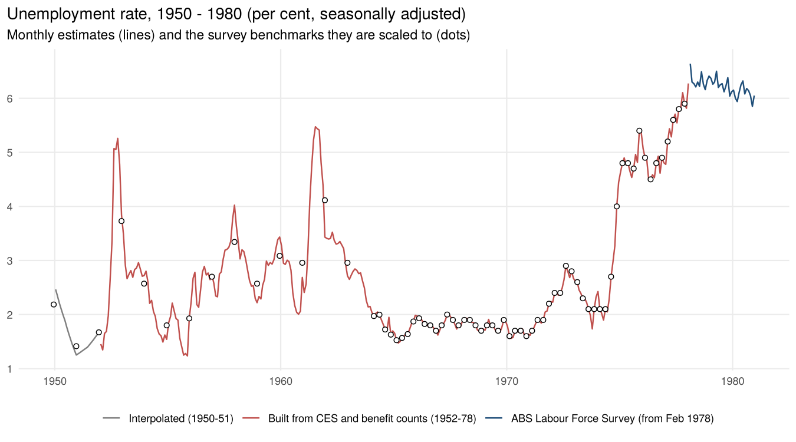
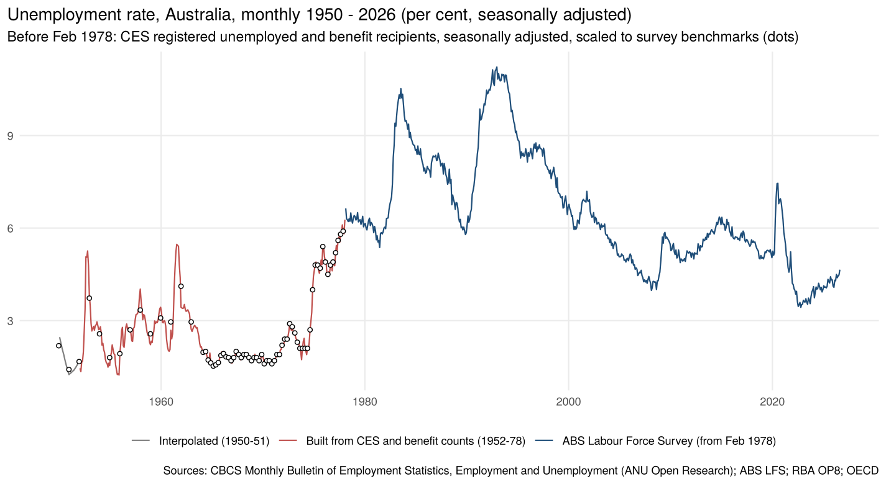

# Monthly unemployment rate, 1950 – 2026

A seasonally adjusted monthly unemployment rate for Australia from January 1950.

- **From February 1978:** the ABS monthly Labour Force Survey.
- **1952 – January 1978:** built from monthly administrative counts:
  - persons registered as unemployed with the Commonwealth Employment Service (CES);
  - persons receiving unemployment benefit.

  These are seasonally adjusted and scaled to the survey estimates that exist: quarterly from
  1964, and financial-year averages before that.
- **1950 – 1951:** only the June CES counts exist, so these months are interpolated.

## Sources

| Period | Series | Source |
|---|---|---|
| 1952 – Apr 1963 | Persons on unemployment benefit at the end of each month (Department of Social Services) | CBCS *Monthly Bulletin of Employment Statistics*, Dec 1952 – Apr 1963 issues (ANU Open Research) |
| Jun 1957 – Dec 1963 (Junes from 1957, monthly from Dec 1961) | Persons registered for employment with the CES (Department of Labour and National Service) | *Monthly Bulletin of Employment Statistics* (1962–63); CBCS/ABS *Employment and Unemployment* (from Oct 1963) |
| 1964 – Jan 1978 | CES registered unemployed, monthly, original (and the bulletins' seasonally adjusted figures, for checking) | *Employment and Unemployment*, 1963–1975 issues; [`02-beveridge-curve`](../02-beveridge-curve) transcriptions for 1965–78 |
| Junes 1950 – 1956 | CES registered unemployed at the end of June | RBA Occasional Paper No. 8 (via `02-beveridge-curve`) |
| 1949-50 to 1962-63 | Unemployment rate, financial-year average (pre-1966 survey basis) and labour force | RBA Occasional Paper No. 8 |
| Feb 1964 – May 1966 | Unemployed and labour force, quarterly, pre-1966 survey basis | OECD Main Economic Indicators (via `02-beveridge-curve`) |
| Aug 1966 – Feb 1978 | Unemployment rate and labour force, quarterly survey (ABS revised historical series) | OECD/FRED copy of ABS 6202.0 (via `02-beveridge-curve`) |
| Feb 1978 – Aug 2026 | Unemployment rate, unemployed and labour force, monthly, seasonally adjusted | OECD/FRED copy of ABS 6202.0 (`LRUNTTTTAUM156S`, `LFUNTTTTAUM647S`, `LFACTTTTAUM647S`) |

`data-raw/ces_benefit_raw.csv` records the issue, page and table of every value transcribed here. The CES dates are the Friday nearest the end of the month, so a date in the first week of a month is counted as the previous month.

## Method (`R/unemployment_monthly.R`)

1. **Monthly CES registered unemployed, 1952 – Jan 1978.**
   - **From Dec 1961:** the CES counts themselves. Where a month was printed in several issues,
     the latest is used.
   - **July 1973 definition change.** The Department of Labour narrowed the definition. Jul 1973
     – Jan 1974 were published on both bases, and the new basis is 5.5% lower. Earlier months are
     scaled by that ratio.
   - **Before Dec 1961, and two gaps in 1962:** unemployment benefit recipients multiplied by the
     ratio of CES registrations to benefit recipients. The ratio is measured each June (when both
     were published) and in 1961–63, and interpolated between. It ranges from about 2 (1953) to
     over 7 (1955), because benefit eligibility was much narrower than registration.
   - **Feb – Mar 1969:** the bulletin was suspended, so these two months are interpolated.
2. **Seasonal adjustment:** STL (base R) on the logs, separately for the three sources, because
   their seasonal patterns differ:
   - benefit-based (to Nov 1961);
   - CES, old definition;
   - CES, revised definition (a fixed seasonal pattern, as there are only 4½ years).

   Against the seasonally adjusted figures the bulletins printed for 58 months of 1963–75, the
   average gap is 3%.
3. **Scaling to the survey.** The survey counts more people as unemployed than register with the
   CES. At each survey benchmark, the ratio of survey unemployed to seasonally adjusted CES
   registrations is calculated, and interpolated (in logs) between benchmarks.

   | Period | Survey benchmark | Survey / CES ratio |
   |---|---|---|
   | 1949-50 to 1962-63 | RBA financial-year average rate × 1.29 | 1.2 – 7.2 |
   | Feb 1964 – May 1966 | OECD quarterly (pre-1966 survey) × 1.29 | 1.6 – 2.0 |
   | Aug 1966 – Feb 1978 | ABS quarterly survey (Feb 1978: first monthly survey) | 1.4 – 1.9 to mid-1973; 1.0 – 1.7 after, as CES registrations rose faster |

   - **The 1.29 factor:** the pre-1966 survey basis gave lower rates. In Aug 1966 the RBA gives
     1.4% on the old basis and the ABS 1.8% on the current basis (see `02-beveridge-curve`).
   - **Financial-year benchmarks:** the ratio is solved iteratively, so that each year's monthly
     estimates average exactly to the benchmark.
4. **Labour force:** interpolated (log-linear) between the benchmark dates. The rate is
   unemployed ÷ labour force.

## Results

| Episode | Peak, monthly SA |
|---|---|
| 1952–53 credit squeeze | 5.3% (Oct 1952) |
| 1957–58 | 4.0% (Dec 1957) |
| 1961 credit squeeze | 5.5% (Jul 1961) |
| Long boom, 1964–71 | 1.5 – 2.2% throughout |
| 1974–75 | rises from 2.1% (Jun 1974) to 4.4% (Dec 1974) and 4.7% (Jun 1975) |

The 1950s and early 1960s were far more volatile than the steady "full employment" average
suggests. Unemployment roughly doubled within months in 1952 and again in 1961, then fell back
nearly as quickly.

## Files

| File | What it is |
|---|---|
| `output/unemployment_rate_monthly.csv` | Jan 1950 – Aug 2026: unemployment rate (SA), unemployed and labour force ('000), method, and for 1952–78 the CES indicator (original and SA), its source, and benefit recipients |
| `output/unemployment_benchmarks.csv` | The survey benchmarks, the CES indicator over each, and the ratio used |
| `data-raw/ces_benefit_raw.csv` | Transcribed CES registrations (original and printed SA, both definitions) and benefit recipients, with issue, page and table |
| `data-raw/lfs_monthly_sa_fred.csv` | ABS monthly LFS (SA), Feb 1978 – Aug 2026, via FRED |

The script also reads the transcriptions and survey files in `../02-beveridge-curve/data-raw`.

## Caveats

- **Level before 1964.** The level rests on the RBA's financial-year estimates, which are not
  from a regular survey, and on the 1.29 basis adjustment. The ratio of these estimates to CES
  registrations moves a lot from year to year (1.2 – 7.2). So the monthly *timing* of turning
  points before 1964 is better founded than the exact level in any one year.
- **Benefit recipients, 1952 – 1961.** These are a narrow measure: married women and recent
  arrivals were often ineligible. From May 1951 to Sep 1952 they count the persons "on the cash
  sheet" rather than those actually on benefit. In 1950–51 there were only a few hundred to a
  thousand recipients, too few to use, so those years are interpolated.
- **Seasonal adjustment** is STL, not the ABS's X-11, and is least reliable at the ends of each
  segment.
- **CES coverage changed over time.** Examples are the 1973 definition change and changes in
  school-leaver registrations. The quarterly survey benchmarks from 1964 absorb these.
