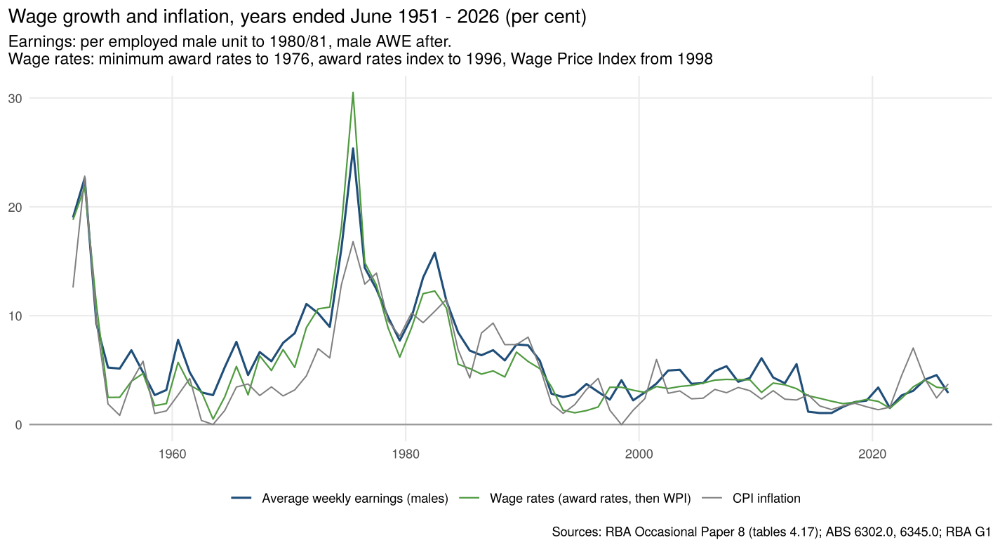
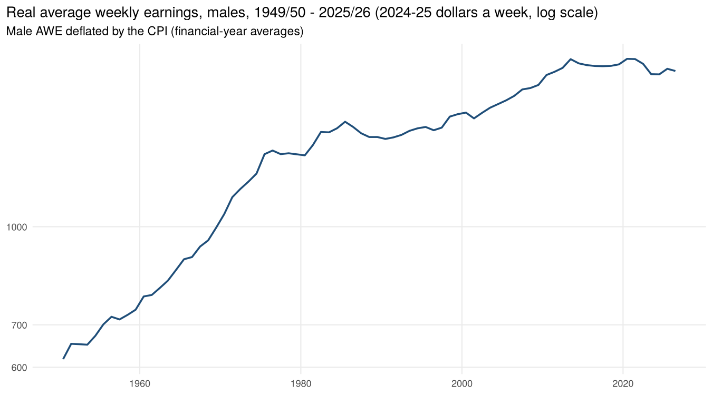
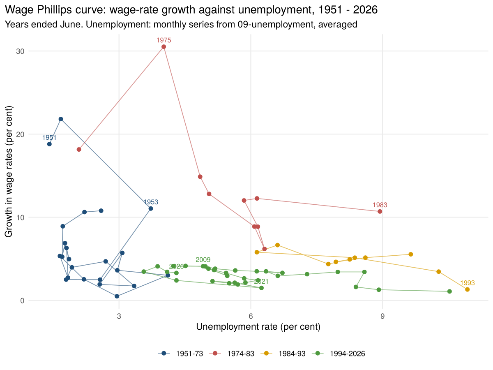

# Wages and earnings, 1949-50 to 2025-26

Annual (years ended June) Australian wage series, nominal and real:

- **average weekly earnings (AWE), males**, 1949-50 to 2025-26;
- **wage rates**, 1949-50 to 2025-26:
  - minimum award rates;
  - the award rates of pay index;
  - the Wage Price Index (WPI);
- growth rates, CPI inflation, real earnings, and the average unemployment rate from
  [`09-unemployment`](../09-unemployment) (for the Phillips curve below).

The WPI is also given quarterly, Sep 1997 – Jun 2026.

## Sources

| Series | Period | Source |
|---|---|---|
| Average weekly earnings per employed male unit (to 1980-81), then male AWE (from 1981-82), spliced by the ABS | 1949-50 – 1995-96 | RBA Occasional Paper No. 8, *Australian Economic Statistics 1949-50 to 1996-97*, table 4.17 |
| Minimum weekly award wage rates, adult males and females (base: award structure of April 1954) | 1949-50 – 1981-82 | OP8 table 4.17 |
| Award rates of pay index, full-time adults (June 1985 = 100) | 1976-77 – 1995-96 | OP8 table 4.17 |
| Average non-farm earnings (national accounts) and Treasury's real unit labour costs | 1966-67 – 1995-96 | OP8 table 4.17 (carried through for reference) |
| AWE survey snapshots, October/November, by sex and full-time status (used as a check) | 1972 – 1994 | OP8 table 4.18 |
| AWE, males and persons, total earnings, original, May and November | Nov 1994 – May 2026 | ABS 6302.0, May 2026, table 3 |
| Wage Price Index, total hourly rates of pay excluding bonuses, all sectors, SA | Sep 1997 – Jun 2026 | ABS 6345.0, Jun 2026, table 1 |
| CPI | | RBA G1 (via `08-money-credit-rates`) |

The OP8 tables are the RBA's spreadsheets of the paper. The paper prints "1958/59" twice; the
first is 1957/58, and years are assigned by position.

## Method (`R/wages.R`)

1. **Male AWE.**
   - **To 1995-96:** OP8's series.
   - **From 1995-96:** the ABS May and November surveys. A financial year is the average of
     November and the following May.
   - **Link:** in the two overlapping years (1994-95, 1995-96), the ABS series is 0.69% and 0.72%
     above OP8. Earlier years are scaled by the average of the two (1.0071).
2. **Wage rates.**
   - **Minimum award rates to the award index:** the minimum male award rates are linked to the
     award rates of pay index over their six overlapping years, 1976-77 to 1981-82. Single years
     are within 0.7% of the link.
   - **Award index to the WPI:** the WPI continues the series from 1997-98. The OP8 index ends in
     1995-96 and the WPI starts in September 1997, so 1996-97 is interpolated using the WPI's
     first-year growth (3.4% a year).
   - **Different concepts:** the three measures are not the same. Award rates are minimum
     rates; the WPI is a fixed-basket price of labour that includes enterprise agreements. The
     joined series shows the broad path of pay rates without changes in the mix of jobs.
3. **Real earnings:** male AWE ÷ CPI (financial-year averages), in 2024-25 dollars.
4. **Check:** year-on-year growth in the Oct/Nov survey snapshots (OP8 table 4.18) tracks the
   financial-year AWE series within 0.7 points on average over 1983–94.

## Results

| Decade (years ended June) | AWE growth | Wage rates growth | CPI inflation | Real AWE growth | Unemployment rate |
|---|---|---|---|---|---|
| 1951–1960 | 8.7 | 7.5 | 6.2 | 2.3 | 2.5 |
| 1961–1970 | 5.6 | 4.1 | 2.5 | 3.1 | 2.3 |
| 1971–1980 | 12.6 | 13.1 | 10.2 | 2.2 | 4.1 |
| 1981–1990 | 9.0 | 7.2 | 8.3 | 0.6 | 7.6 |
| 1991–2000 | 3.2 | 2.7 | 2.2 | 1.0 | 8.8 |
| 2001–2010 | 4.6 | 3.7 | 3.2 | 1.4 | 5.4 |
| 2011–2020 | 2.6 | 2.6 | 2.0 | 0.6 | 5.6 |
| 2021–2026 | 3.1 | 3.0 | 3.9 | −0.7 | 4.4 |

Per cent a year, averages of annual values.

**Real male earnings, per cent a year:**

| Period | Growth |
|---|---|
| 1949-50 to 1974-75 | 3.0 |
| 1974-75 to 1994-95 | 0.5 |
| 1994-95 to 2011-12 | 1.3 |
| 2011-12 to 2025-26 | about 0 |

**The wage Phillips curve** shifts over time:

- **1950s and 1960s:** a steep, low curve.
- **1974-75:** wage rates jumped 30% with unemployment at 4%.
- **1975–83:** wage indexation and the Accord kept wage growth high even as unemployment rose.
- **Since the 1990s:** a flat curve near 2–4% wage growth across unemployment rates from 3.5% to
  11%.

## Files

| File | What it is |
|---|---|
| `output/wages_annual.csv` | Years ended June 1950 – 2026: male AWE ($ a week) and source, persons AWE (from 1995), wage-rates index (2024-25 = 100) and source, growth rates, CPI inflation, real AWE (2024-25 dollars) and growth, real wage-rates growth, unemployment rate, OP8 non-farm average earnings and real unit labour costs |
| `output/wpi_quarterly.csv` | WPI (SA) and year-ended growth, Sep 1997 – Jun 2026 |
| `data-raw/op8_4_17_wages_annual.csv`, `op8_4_18_awe_survey.csv` | The OP8 tables as extracted |
| `data-raw/abs_6302_awe_original.csv`, `abs_6345_wpi_sa.csv` | ABS AWE (May/Nov) and WPI |

## Caveats

- **Earnings per male unit before 1981-82.** Total wages and salaries are divided by male
  employees plus a fraction of female employees. Changes in the mix of jobs, in women's pay
  relative to men's (equal pay decisions of 1969, 1972 and 1974) and in part-time work all move
  this measure. The ABS spliced it to the survey series at 1981-82.
- **AWE is a mix-affected average.** It rises when low-paid or part-time jobs fall away, as in
  2020, and so is noisier than the WPI.
- **Wage rates** join three different measures; growth rates within each segment are the most
  reliable. 1996-97 is interpolated.
- **Annual only before 1995.** The bulletins print quarterly earnings per male unit from 1948-49,
  but those have not been transcribed here. With them, the Phillips curve could be drawn
  quarterly back to the 1950s.
