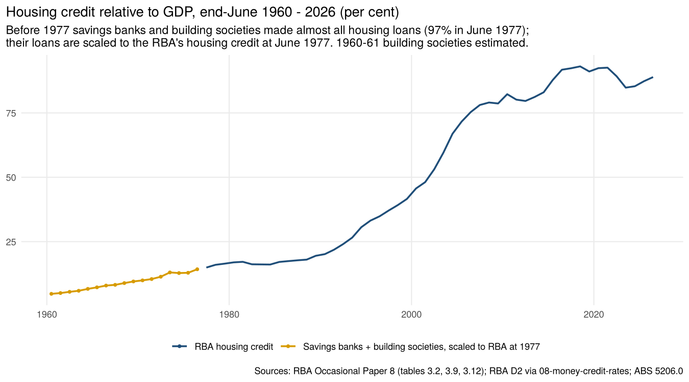
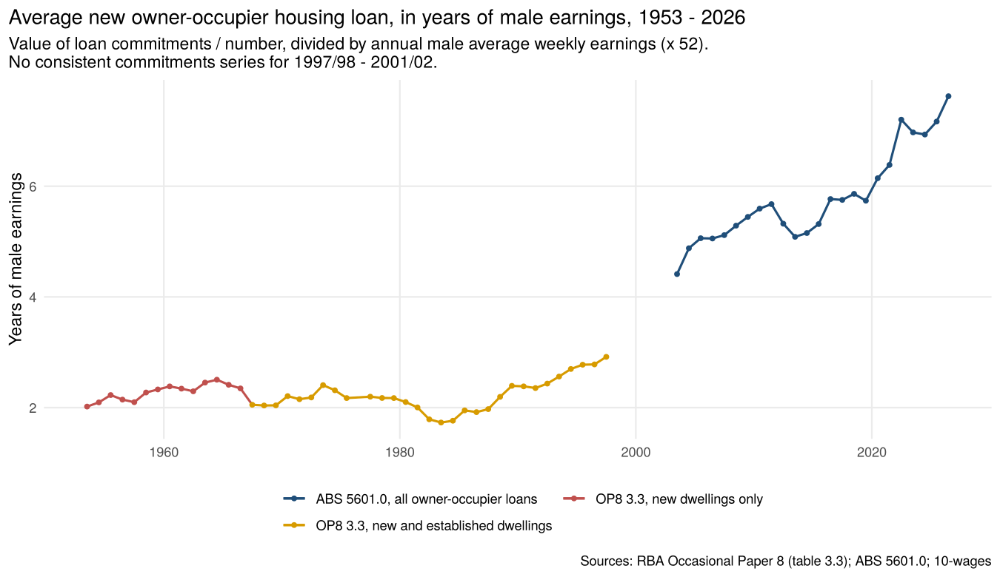
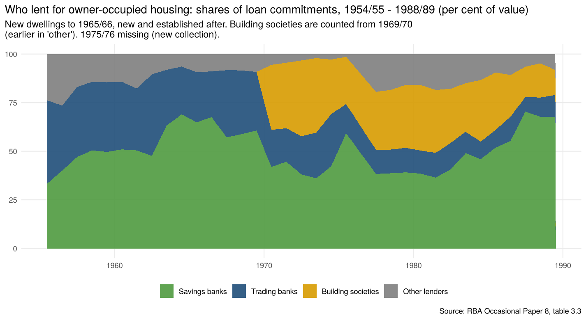

# Housing finance, 1953 – 2026

Annual (years ended June) series on who lent for housing, how much, and how large loans were
relative to earnings:

- **housing credit outstanding**, end-June 1960 – 2026, and its share of GDP;
- **owner-occupier housing loan commitments** by lender, number and value, 1952/53 – 1996/97 and
  2002/03 – 2025/26;
- **average new loan**, in dollars and in years of male earnings.

Dwelling approvals and commencements are in [`03-building-approvals`](../03-building-approvals)
and [`04-housing-pipeline`](../04-housing-pipeline); this section uses the commencements.

## Sources

| Series | Period | Source |
|---|---|---|
| Housing finance commitments to individuals for owner occupation, by lender (banks, of which savings banks; permanent building societies; other), new and established dwellings, number and value | 1952/53 – 1996/97 (established dwellings from 1966/67; building societies from 1969/70) | RBA Occasional Paper No. 8, table 3.3 |
| Owner-occupier new loan commitments excluding refinancing, number and value | Sep 2002 – Sep 2026 (summed to financial years) | ABS 5601.0 *Lending Indicators*, table 1 |
| Savings banks' housing loans, end-June | 1960 – 1989 | OP8 table 3.9 (via `08-money-credit-rates`) |
| Permanent building societies' mortgage loans outstanding, end-June | 1962 – 1977 | OP8 table 3.12 (via `08-money-credit-rates`) |
| Housing credit, break-adjusted | Aug 1976 – Sep 2026 | RBA D1/D2 (via `08-money-credit-rates`) |
| OP8 housing credit (for the 1977 check) | 1977 – 1997 | OP8 table 3.2 |
| Male average weekly earnings, nominal GDP, housing interest rate, dwelling commencements | | `10-wages`, `08-money-credit-rates`, `04-housing-pipeline` |

## Method (`R/housing_finance.R`)

1. **Housing credit before 1977.** No total exists before the RBA's series starts in August
   1976. But in June 1977 savings banks' housing loans ($7,259m) and building societies'
   mortgages ($5,022m) were 97% of OP8's housing credit ($12,642m): almost all housing lending
   went through these two. So housing credit for 1962–1976 is their sum, scaled to the RBA's
   break-adjusted June 1977 level (×1.17; the break-adjusted series is above OP8's
   because the RBA's growth rates are chained back from today's broader coverage).
   - **1960–61:** building societies are not reported, so they are put at their 1962 ratio to
     savings bank housing loans (23%).
   - Savings banks held 81% of the two in 1960 and 59% by 1977, as building societies grew.
2. **Commitments.** OP8 table 3.3 to 1996/97; ABS 5601.0 owner-occupier loans (excluding
   refinancing) from 2002/03. OP8 covers new dwellings only until 1965/66, and adds established
   dwellings from 1966/67. There is no consistent series for 1997/98 – 2001/02 or for 1975/76,
   when a new ABS collection started.
3. **Average loan** = value ÷ number of commitments: new and established dwellings where both
   exist, new dwellings only before 1966/67. Over 1966/67 – 1995/96 the average new-dwelling
   loan was 0.88 – 1.09 times the average for all loans, so the earlier years are comparable.
   **Years of earnings** = average loan ÷ (male AWE × 52).
4. **New-dwelling loans per dwelling started** = number of new-dwelling commitments ÷
   dwelling commencements in the year (`04-housing-pipeline`).

## Results

| June | Housing credit, % of GDP | Average new loan | Years of male earnings | New-dwelling loans per start |
|---|---|---|---|---|
| 1960 | 4.7 | $5,145 | 2.4 | 0.35 |
| 1970 | 9.9 | $8,219 | 2.2 | 0.39 |
| 1977 | 14.9 | $20,445 | 2.2 | 0.61 |
| 1985 | 17.1 | $39,955 | 2.0 | 0.55 |
| 1990 | 20.1 | $67,690 | 2.4 | 0.56 |
| 2000 | 45.7 | | | |
| 2010 | 82.3 | $341,306 | 5.6 | |
| 2018 | 93.1 (peak) | $437,903 | 5.9 | |
| 2026 | 88.9 | $724,408 | 7.6 | |

- **Housing credit** grew steadily relative to GDP under regulation, from 5% in 1960 to 15% in
  1977, then barely moved to 1988 (16–18%). After deregulation it rose to 46% by 2000 and 93% by
  2018.
- **Loan size** stayed near two years of male earnings for 40 years (1.7 – 2.5 from 1953 to
  1990). It then rose to 2.9 by 1997, 4.4 by 2003, 5.6 by 2010 and 7.6 in 2025/26.
- **Who lent:** savings banks were the largest lender throughout, with half or more of
  owner-occupier loans from the late 1950s to the late 1960s. Permanent building societies'
  share rose to about a third in the 1970s, then fell in the late 1980s as savings banks' share
  rose to two-thirds, just before the distinction between savings and trading banks was
  abolished (1990).
- **Few new homes were bank-financed in the 1950s and 1960s:** loans for new dwellings
  numbered only a third of dwellings started. Many homes were built with state housing
  authority, War Service Homes or other government finance, family money, or by their owners.

## Files

| File | What it is |
|---|---|
| `output/housing_finance_annual.csv` | Years ended June 1953 – 2026: housing credit ($m, % of GDP, growth, source), savings bank housing loans and building society mortgages, commitments (number and value; new, established, all; by lender), average loan and its basis, years of male earnings, dwelling starts and new-dwelling loans per start, commitments % of GDP, housing interest rate, male AWE, nominal GDP |
| `data-raw/op8_3_3_housing_finance_commitments.csv` | OP8 table 3.3, with its notes on breaks |
| `data-raw/abs_5601_owner_occupier_commitments_fy.csv` | ABS 5601.0 owner-occupier commitments summed to financial years |

## Caveats

- **Housing credit before 1977** assumes that lending by others (trading banks, life offices,
  credit unions, terminating building societies, state housing banks) stayed in the same
  proportion to savings bank and building society lending as in 1977. Lenders such as state
  housing authorities and War Service Homes were bigger in the 1950s and 1960s, so the earlier
  ratios to GDP are probably understated.
- **Building society data** have breaks in 1969 and 1975 (OP8 table 3.12 notes) that are not
  adjusted.
- **Commitments** change coverage over time (OP8 notes h–m). The 1996/97 → 2002/03 change from
  OP8 to ABS 5601.0 is a change of collection, so the jump in loan size between them (2.9 to 4.4
  years of earnings) is partly definitional. House prices also rose fast over 1997–2003.
- **Male AWE** is total earnings of all male employees (including part-time) from 1981/82, so
  the earnings denominator is somewhat lower than full-time earnings would be.
