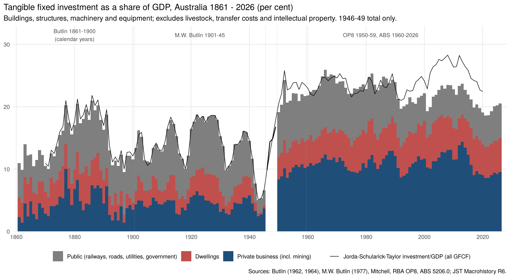
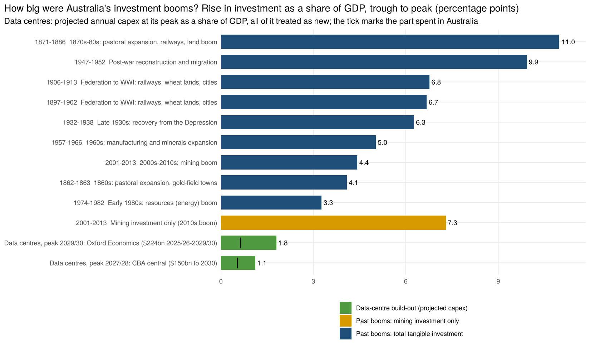
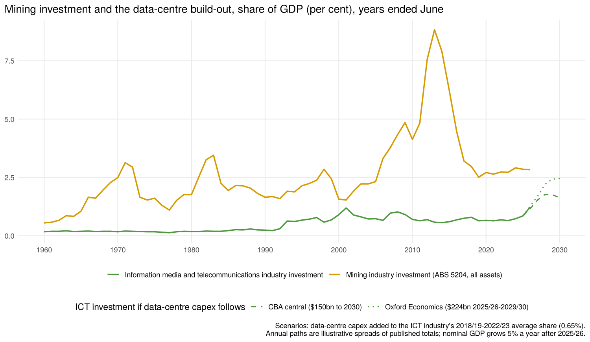

# Investment booms, 1861 – 2026, and the data-centre build-out

Investment as a share of GDP every year from 1861 to 2025/26, split into dwellings, private business
and public investment. The series is used to rank Australia's investment booms and to set the
projected data-centre (AI) build-out against them and against the 2000s–2010s mining boom.

## Answer in brief

- **The biggest investment booms came in the 19th century and just after World War II**, not
  in the recent mining boom.
  - **1870s–80s (pastoral expansion, railways and the land boom).** Investment rose from 10% of
    GDP in 1871 to 21% in 1886 and stayed near 20% until 1891. Public works (mostly railways)
    and private business investment (mostly pastoral improvements: fencing, water, buildings)
    each added about 5 percentage points. Butlin's later (1964) estimates put the peak higher
    still, at about 26% of GDP.
  - **Post-war reconstruction and migration.** Investment rose from 14% of GDP in 1946/47 to 24%
    in 1951/52.
- **The 2000s–2010s mining boom was the biggest boom in a single industry.** Mining investment
  rose from 1.5% of GDP in 2000/01 to 8.8% in 2012/13. But other business investment and
  dwelling investment fell as a share of GDP, so total investment rose only from 19.3% to 23.7%
  (+4.4 points). The 1870s pastoral boom is the nearest rival in one sector: private business
  investment, mostly pastoral, rose by about 8 points of GDP between 1867 and 1877.
- **The data-centre build-out is much smaller, so far.** Published estimates imply annual
  data-centre capex peaking at about 1.1% of GDP (CBA's central estimate, $150bn by 2030) to
  1.8% (Oxford Economics, $224bn over 2025/26–2029/30). That is a quarter of the mining boom's
  rise or less, and similar to the 1960s and early-1980s mineral booms (+2.4 – 2.6 points of
  GDP in mining).
  - Most of the spending is on imported IT equipment, so only 35 – 50% of it is spent in
    Australia. That share is roughly 0.5 – 0.6% of GDP at the peak.
  - The build-out is already visible in the national accounts. Investment by the information
    media and telecommunications industry, where data-centre operators are classified, was 1.23%
    of GDP in 2025/26, against an average of 0.65% over 2018/19 – 2022/23. That is above its
    peak in the 2000/01 telecoms boom (1.19%).

## Booms

All figures are shares of GDP, in per cent; rises are in percentage points. Years are calendar years
to 1900 and years ended June from 1901.

| Boom | Trough | Peak | Rise | What rose |
|---|---|---|---|---|
| 1870s–80s: pastoral expansion, railways, land boom | 1871: 10.0 | 1886: 21.0 | **11.0** | Public (railways) +5.0, business (pastoral, industrial, commercial) +4.9, dwellings +1.0 |
| Post-war reconstruction and migration | 1946/47: 14.4 | 1951/52: 24.3 | **9.9** | All three; split not available for 1946/47 |
| Federation to WWI: railways, wheat lands, cities | 1905/06: 11.1 | 1912/13: 17.8 | 6.8 | Public +4.4, dwellings +1.6 |
| End of the 1890s depression to Federation | 1897: 9.5 | 1901/02: 16.2 | 6.7 | Business +3.6, dwellings +2.8 (crosses the join between the two Butlin series; see caveats) |
| Recovery from the Depression | 1931/32: 9.8 | 1937/38: 16.1 | 6.3 | Business +2.6, dwellings +2.1, public +1.6 |
| 1960s manufacturing and minerals expansion | 1956/57: 20.9 | 1965/66: 26.0 | 5.0 | Public +2.3, business +2.0 |
| **2000s–2010s mining boom** | 2000/01: 19.3 | 2012/13: 23.7 | 4.4 | Business +4.1 (mining +7.3, other business down about 3), public +0.8, dwellings −0.5 |
| Early-1980s resources (energy) boom | 1973/74: 22.1 | 1981/82: 25.4 | 3.3 | Business +2.5 |

Booms in single components (from `output/investment_booms.csv`):

| Component | Largest rises |
|---|---|
| Mining investment | 2000/01–2012/13 **+7.3** (1.5 → 8.8); 1959/60–1970/71 +2.6; 1976/77–1982/83 +2.4 |
| Private business | 1867–1877 **+8.1** (pastoral); 2001/02–2012/13 +4.3; 1883–1886 +4.0; 1897–1906/07 +4.0; 1976/77–1988/89 +3.6 |
| Public | 1905/06–1912/13 +4.4; 1874–1886 +4.1 (railways peaked at 6.4% of GDP in Butlin's 1886 figures); 1949/50–1951/52 +2.5 |
| Dwellings | 1871–1883 +3.1; 1900–1901/02 +3.0; 1931/32–1938/39 +2.3; 1974/75–1980/81 +2.0 |

The **1920s** are not a boom by this measure. Investment returned to about its 1913 share
(18 – 19% of GDP) rather than rising above it. The **late 1880s** in Melbourne were the peak of a
boom that began in the 1870s, not a separate one.

### How a boom is identified (`R/investment_booms.R`, section 2)

A boom is measured from a trough to a peak:

- **Peak.** A peak is a year with the highest share within four years either side. It is then
  moved forward to the top of any plateau that follows. The plateau ends when the share falls by
  more than a third of the rise.
- **Trough.** The trough is the lowest share in the 12 years before the peak. Wartime years
  (1915–1919 and 1940–1946) do not count as troughs.
- **Selection.** Episodes are taken largest first and may not overlap. A total boom must rise at
  least 2.5 points and a component boom at least 1.5 points.

## Data-centre scenarios

| Scenario | Total | Peak year | Peak capex, % of GDP | Spent in Australia, % of GDP |
|---|---|---|---|---|
| CBA central | $150bn, 2025/26 – 2029/30 | 2027/28 – 2028/29 | 1.1 | 0.5 (48%, the ratio implied by Westpac's estimate) |
| Oxford Economics | $224bn, 2025/26 – 2029/30 | 2029/30 | 1.8 | 0.6 (35%, Oxford's estimate) |

- **Annual paths.** The sources give totals and peak timing, so the annual paths in
  `data-raw/data_centre_scenarios.csv` are illustrative spreads of those totals. Nominal GDP is
  assumed to grow by 5% a year after 2025/26.
- **Other estimates.** CBA's full pipeline is about $260bn by the mid-2030s. That is $110bn more
  after 2030, so the peak share is about the same and the boom lasts longer. Westpac puts the
  pipeline above $155bn (5.6% of a year's GDP), and about $200bn more for the energy transition.
- **How the bars and ticks are measured.** The scenario bars count all data-centre capex as new
  investment. The past booms are measured as rises in total investment, which nets out any fall
  in other investment. The tick shows the part spent in Australia, which is what adds to
  Australian activity. Much of the mining boom's spending on equipment was also imported.

## Sources and method

Links to every source are in [`SOURCES.md`](../SOURCES.md).

| Years | Source | What is used |
|---|---|---|
| 1861 – 1900 (calendar) | N.G. Butlin (1962), *Australian Domestic Product, Investment and Foreign Borrowing*, tables 1 and 4, as compiled by Jones and Obstfeld (NBER) | Gross domestic capital formation, public and private, excluding livestock; GDP at market prices |
| 1861 – 1900 | N.G. Butlin (1964), *Investment in Australian Economic Development 1861–1900*, tables 9 and 10 (pp. 47–48), read from the ANU Open Research scan | Composition. Private: residential, industrial, commercial, mining, shipping and pastoral. Public: railways, telegraphs, water and sewerage, buildings, roads, bridges, defence and local authorities. All as % of GDP. Every row adds to its printed total within 0.04 |
| 1900/01 – 1944/45 | M.W. Butlin (1977), RBA RDP 7701, table IV.1 (via Jones and Obstfeld) | Fixed capital formation: private dwellings, private non-dwelling, public dwellings, public non-dwelling; GDP |
| 1945/46 – 1948/49 | Mitchell, *International Historical Statistics*, table J1 (via the Global Macro Database repository) | Total GFCF and GDP; no split by type |
| 1949/50 – 1958/59 | RBA Occasional Paper 8, table 5.1a | Private dwellings, non-dwelling construction, equipment; public investment; GDP |
| 1959/60 – 2025/26 | ABS 5206.0 table 3 (quarters summed to years ended June); ABS 5204.0 table 52 | GFCF by sector and asset; private GFCF by industry (mining, information media and telecommunications) |
| 1870 – 2020 | Jordà-Schularick-Taylor Macrohistory Database R6 | Investment/GDP, as a cross-check |
| 2026 – 2030 | CBA, Oxford Economics, Westpac (2026) | Data-centre capex estimates |

**Measure.** The main series is tangible fixed investment: buildings, structures, machinery and
equipment, private and public. It leaves out the following, which the historical estimates do not
include:

- livestock and orchards (cultivated biological resources, 7% of GDP in 1959/60 in today's ABS
  figures but under 0.4% since 2010);
- ownership transfer costs;
- intellectual property products (software, R&D, mineral exploration: 2.4% of GDP in 2025/26,
  private).

All GFCF as the ABS now measures it is in the output file as `gfcf_all`. It was 24.8% of GDP in
2025/26, against 20.5% for the tangible measure.

**Joins.**

1. **1861–1900.** The Butlin (1964) components add up to more than Butlin's 1962 total. On
   average the 1962 total is 0.85 times their sum (range 0.68 – 1.00). This is because of later
   revisions and because the pastoral series partly includes livestock. The 1964 components are
   scaled to the 1962 total each year. The unscaled 1964 total is kept as `total_1964`.
2. **1949/50 – 1958/59.** OP8's shares are put on the ABS basis by their average ratio to ABS
   over 1959/60 – 1963/64: dwellings 0.875, business 0.963, public 0.976. Today's ABS GDP is
   higher than OP8's.
3. **1945/46 – 1948/49.** Mitchell's total is scaled by its 1949/50 – 1953/54 ratio to the
   spliced OP8 series (0.845).
4. **No splice at 1901 or 1945.** Each Butlin series uses its own GDP. M.W. Butlin's series
   matches the JST figures for 1901–1945, because JST uses it.

**Mining.** Mining investment is Butlin's private mining series to 1900 and ABS 5204.0 private
GFCF by the mining industry from 1959/60. The ABS series covers all assets, including
exploration. There is no annual series for 1901–1959.

## Checks

- **Butlin (1964) tables 9 and 10.** Every row's components add to the printed total within
  0.04 points.
- **Comparison with JST investment/GDP:**
  - 1870–1900: 0.6 points lower on average (JST uses a different GDP);
  - 1901–1945: identical (both use M.W. Butlin);
  - 1950–2020: about 1.6 – 1.8 points lower. JST covers all GFCF and is on an older basis. Since
    the 1990s the gap widens because JST includes software and R&D.
- **Data-centre scenarios against the national accounts.** In 2025/26, information media and
  telecommunications investment was 0.58 points above its pre-boom average. The scenarios have
  data-centre capex of 0.5 – 0.6% of GDP in that year.

## Files

| File | What it is |
|---|---|
| `output/investment_share_gdp_1861_2026.csv` | Each year: dwellings, business, public and total tangible investment as % of GDP; mining; public railways (to 1900); Butlin 1964 total (to 1900); ICT-industry investment, private IPP, livestock, transfer costs and all GFCF (from 1959/60); JST investment/GDP; source |
| `output/investment_booms.csv` | Every boom found, total and by component: trough and peak years and shares, rise, change by component, era |
| `output/data_centre_scenarios_pct_gdp.csv` | Scenario capex by year, projected GDP, % of GDP, part spent in Australia |
| `data-raw/butlin1964_t9_private_pct_gdp.csv`, `butlin1964_t10_public_pct_gdp.csv` | Transcriptions of Butlin (1964) tables 9 and 10 |
| `data-raw/butlin_ngb1962_gdp_gdcf_1861_1901.csv` | N.G. Butlin (1962): GDP, gross domestic capital formation and livestock accumulation (£) |
| `data-raw/butlin_mwb1977_gfcf_by_type_fy1901_1945.csv` | M.W. Butlin (1977): GDP and fixed capital formation by type ($m) |
| `data-raw/mitchell_gdp_gfcf_fy1945_1960.csv` | Mitchell: GDP, GFCF, stocks ($m) |
| `data-raw/op8_5_1a_expenditure_gdp_current.csv` | OP8 table 5.1a ($m) |
| `data-raw/abs_5206_gfcf_by_sector_asset_fy.csv`, `abs_5204_t52_private_gfcf_by_industry_fy.csv` | ABS national accounts ($m, years ended June) |
| `data-raw/jst_r6_australia_iy.csv` | JST Macrohistory R6, Australia |
| `data-raw/data_centre_scenarios.csv` | Data-centre capex totals and illustrative annual paths, with sources |

## Caveats

- **Composition before 1901.** Butlin's "pastoral" investment is improvements to pastoral
  runs. In the 1964 tables it partly includes additions to livestock. Scaling to the 1962 total
  removes the average excess but not its timing, so the 1870s pastoral boom may be overstated.
- **1897–1902.** This boom straddles the change from calendar-year Butlin (1962) estimates to
  financial-year M.W. Butlin (1977) estimates. In the one overlapping year (calendar 1901
  against 1900/01) the two put investment at 14.1% and 13.4% of GDP.
- **The 1850s gold rush has no investment estimates.** Butlin's series begin in 1861.
- **Level comparisons across sources are rougher than comparisons within one.** Each source
  measures GDP differently. Today's GDP includes items that historical estimates did not, such as
  software and the imputed output of owner-occupied housing. This lowers modern investment
  shares a little against earlier ones. Rises within a boom are measured within one source,
  except for 1897–1902.
- **Data-centre estimates move fast.** These are private-sector estimates published in 2026.
  Their annual paths here are illustrative.
