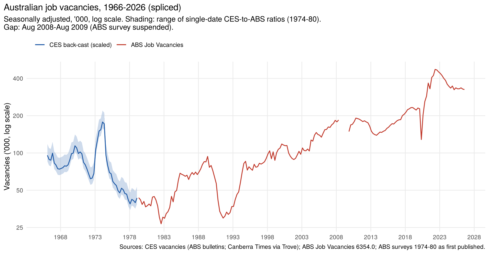
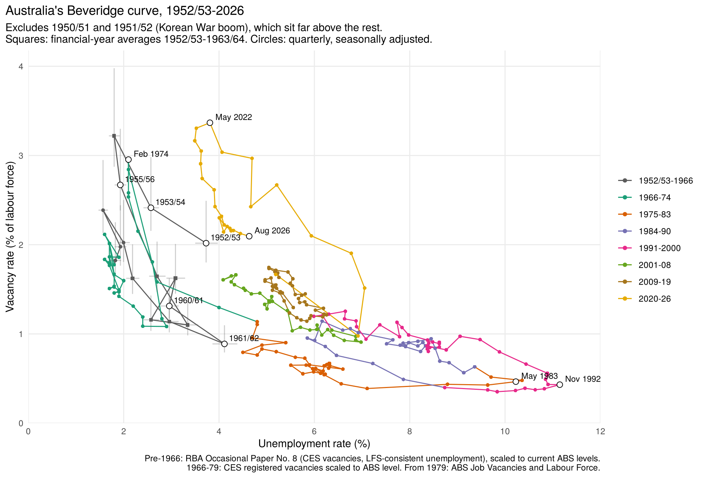
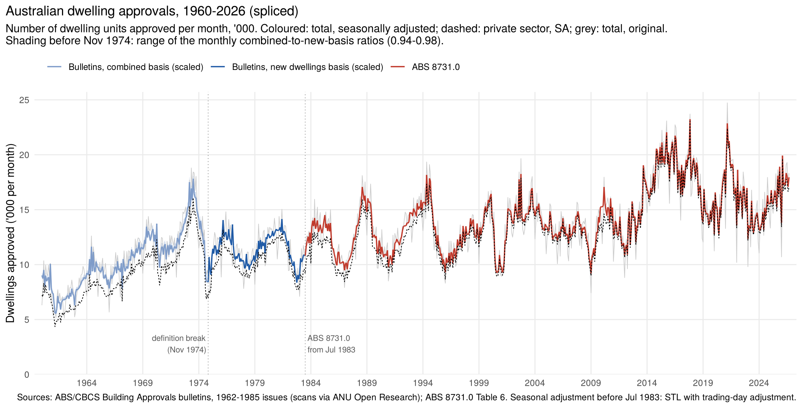
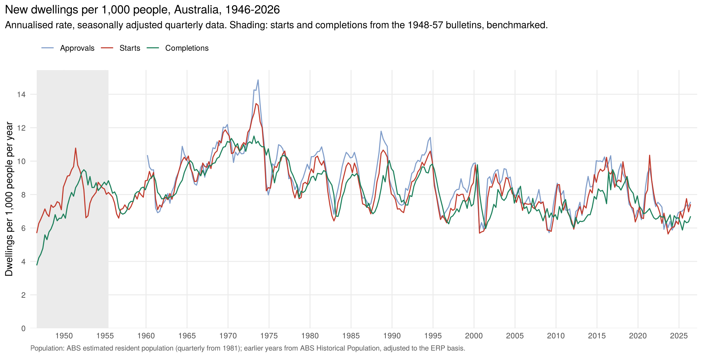
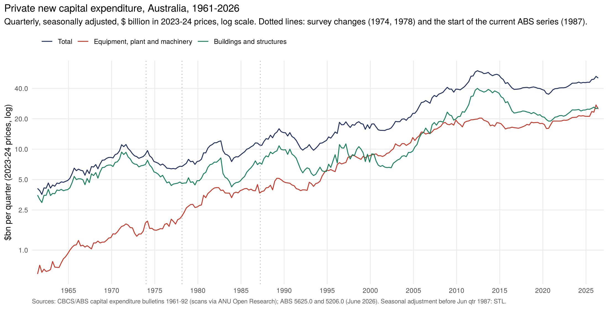
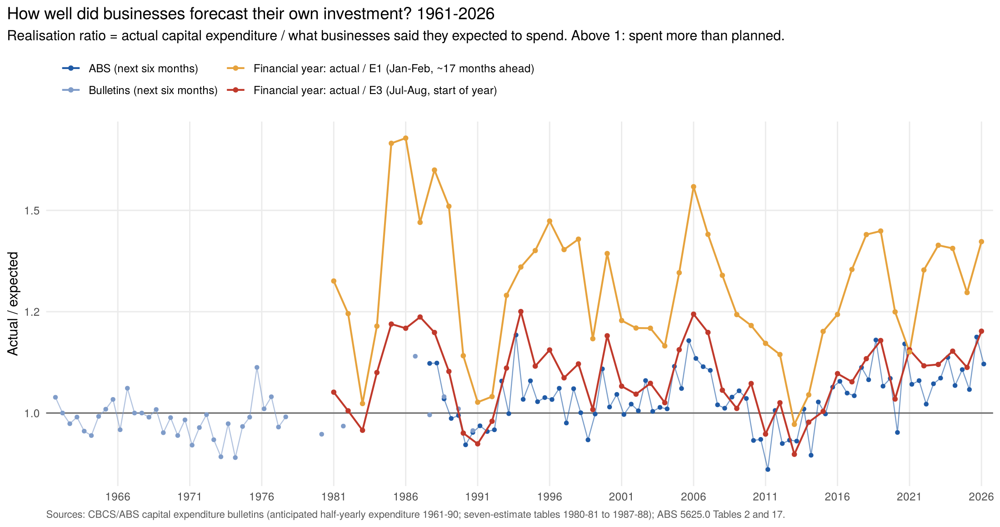
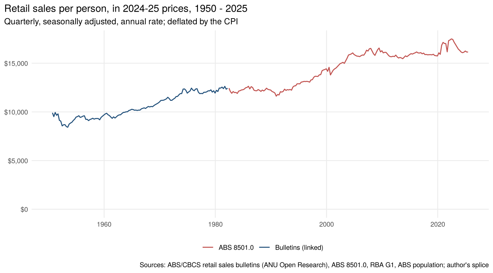
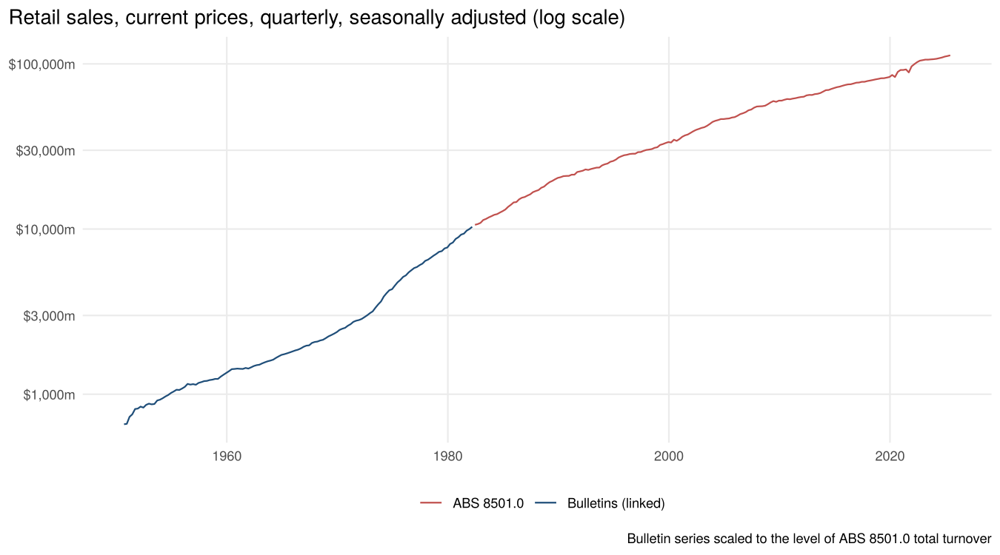
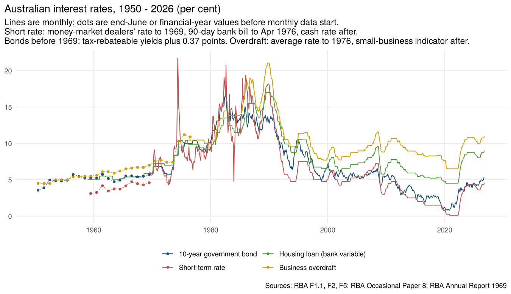
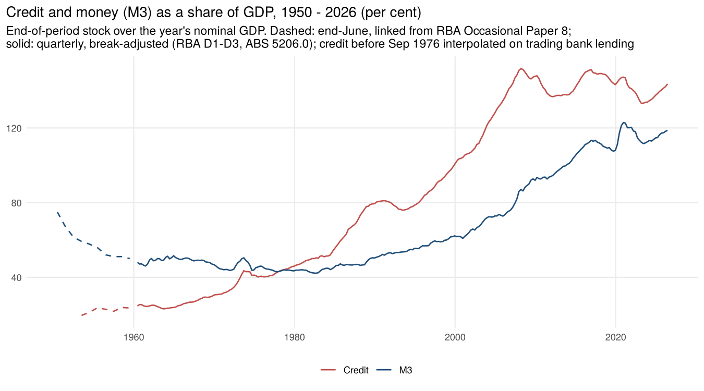

# historic-aus-data

Long-run Australian macroeconomic series rebuilt from scanned statistical bulletins
and joined ("spliced") onto the current ABS series, with seasonal adjustment, checks
and R code to reproduce every number.

Most of the historical figures were read off page images of old Commonwealth Bureau of
Census and Statistics (CBCS) and ABS bulletins digitised by
[ANU Open Research](https://openresearch-repository.anu.edu.au). The OCR text of
those scans is unusable, so each table was read from a high-resolution render of the
page. Every transcribed row records the bulletin issue and page it came from, and
the tables were checked by adding up their parts (e.g. males + females = total,
quarters = printed year total). Where a period was printed in more than one issue,
the latest issue is used because it carries revisions.

## What's here

| Folder | Series | Period | Frequency |
|---|---|---|---|
| [`01-job-vacancies`](01-job-vacancies) | Commonwealth Employment Service (CES) unfilled vacancies, seasonally adjusted and spliced onto ABS Job Vacancies (6354.0) | 1962 (June only), Dec 1965 – Aug 2026 | Monthly / quarterly |
| [`02-beveridge-curve`](02-beveridge-curve) | Beveridge curve: vacancy rate against unemployment rate | 1950/51 – Aug 2026 | Annual to 1963/64, then quarterly |
| [`03-building-approvals`](03-building-approvals) | Dwelling units approved, total and private, spliced onto ABS 8731.0 | Jan 1960 – Sep 2026 | Monthly |
| [`04-housing-pipeline`](04-housing-pipeline) | New dwellings commenced (starts) and completed, with approvals | Sep qtr 1946 – Jun qtr 2026 | Quarterly |
| [`05-housing-per-capita`](05-housing-per-capita) | Quarterly population (total, 15–64, 15+) and the housing pipeline per 1,000 people | 1946 – 2026 | Quarterly |
| [`06-capex`](06-capex) | Private new capital expenditure by asset and industry, spliced onto ABS 5625.0; businesses' investment expectations vs actual | 1961 – 2026 | Quarterly / half-yearly / financial year |
| [`07-retail-sales`](07-retail-sales) | Retail turnover, nominal and real, per person, spliced across five census re-basings onto ABS 8501.0 | 1947-48 – Jun 2025 | Monthly from 1961, quarterly from 1950, financial years from 1947-48 |
| [`08-money-credit-rates`](08-money-credit-rates) | Cash rate, bills, 10-year bond, housing and business lending rates; currency, M3, broad money; break-adjusted credit; trading bank, savings bank and non-bank lending 1957–76 (bulletin scans); bank and non-bank lending from 1953; break-even inflation and inflation expectations from 1985; real rates and shares of GDP | 1950 – Oct 2026 | Monthly from 1959 (1969 for bills and bonds), years ended June from 1950 |
| [`09-unemployment`](09-unemployment) | Monthly unemployment rate: CES registered unemployed and benefit recipients (bulletin scans), seasonally adjusted and scaled to survey benchmarks, joined to the ABS monthly Labour Force Survey | Jan 1950 – Aug 2026 | Monthly |
| [`10-wages`](10-wages) | Male average weekly earnings and wage rates (award rates, award index, WPI), nominal and real, with annual and quarterly wage Phillips curves | 1949-50 – 2025-26 | Years ended June; quarterly male AWE 1949–2012 (bulletin scans) and WPI from 1997 |
| [`11-housing-finance`](11-housing-finance) | Housing credit outstanding and its share of GDP (savings banks and building societies before 1977); owner-occupier loan commitments by lender; average loan in years of male earnings | 1953 – 2026 | Years ended June |

Each folder has the same layout:

```
R/          scripts (run from the analysis folder)
data-raw/   transcriptions and downloaded source data
output/     the finished series (CSV) and charts (PNG)
README.md   method, sources, checks and caveats
```

## All series in one file

[`data/aus_historic_series.csv`](data/aus_historic_series.csv) holds the headline series from
every folder in long format: `series_id`, `date` (YYYY-MM, the last month of the period),
`value`. That is 85 series and about 28,000 observations: 32 monthly, 27 quarterly and
26 annual (years ended June).
[`data/series_catalogue.csv`](data/series_catalogue.csv) gives each series' description, unit,
seasonal adjustment, frequency, first and last date, and the output file and column it comes
from. In R:

```r
source("R/load_aus_series.R")   # from a clone; falls back to GitHub if data/ is not found
aus_catalogue()                                  # list the series
aus_series("unemployment_rate_m")                # one series, long format
aus_series(c("awe_male_a", "cpi_inflation_a", "credit_pct_gdp_a"), wide = TRUE)
aus_series(section = "08-money-credit-rates", frequency = "M")
```

The file is rebuilt by `R/build_combined.R`, which `run_all.R` runs last. The list of series
is set in that script; the folders' output files have more columns (sources, methods,
low/high ranges, components).

## Headline charts

| | |
|---|---|
|  |  |
|  |  |
|  |  |
|  |  |
|  |  |

## Reproducing

Requires R (4.1 or later) with `readr`, `dplyr` and `ggplot2`. From the repository root:

```r
Rscript run_all.R
```

This rebuilds every output in dependency order:

```
01-job-vacancies ──► 02-beveridge-curve ──► 09-unemployment ──► 10-wages (also uses 08's CPI)
03-building-approvals ──► 04-housing-pipeline ──► 05-housing-per-capita ──► 07-retail-sales
06-capex ──────────────────────────────────────────────► 08-money-credit-rates (uses 06's GDP)
04, 08, 10 ──► 11-housing-finance
```

Each script prints its checks (sum checks, splice ratios, overlap comparisons) as it runs.

## How the splices work, in one paragraph

Old and new series are joined by comparing them over months or quarters where both
exist, always using original (not seasonally adjusted) figures for the same period so
seasonality cancels. The old series is scaled by the average (geometric mean) ratio
and the range of single-period ratios is reported as an uncertainty band. Where a
definition changed inside the old bulletins (e.g. building approvals in 1974–75, or
houses-only vs houses-and-flats in the 1950s), the same overlap or benchmarking logic
is applied at that break too. Seasonal adjustment uses the ABS's own published
seasonally adjusted series wherever it exists and STL (base R) before that, checked
against the seasonally adjusted figures printed in the old bulletins.

## Sources

- ABS / CBCS bulletins (scans): ANU Open Research repository —
  *Employment and Unemployment*, *Building Approvals*, *Quarterly Bulletin of Building Statistics*,
  capital expenditure surveys (1961–1992), *Retail Sales of Goods* (1952–1983),
  *Quarterly Summary of Australian Statistics*
- ABS current releases: Job Vacancies (6354.0), Labour Force (6202.0), Building Approvals (8731.0),
  Building Activity (8752.0), Private New Capital Expenditure (5625.0), National Accounts (5206.0),
  Retail Trade (8501.0),
  National, state and territory population (3101.0),
  Historical Population (3105.0.65.001)
- RBA statistical tables F1.1, F2, F5 (interest rates), D1–D3 (money and credit), H3 (building
  approvals cross-check) and G1 (consumer price index); RBA Annual Report 1969
- RBA Occasional Paper No. 8, *Australian Economic Statistics 1949–50 to 1996–97* (labour, money,
  credit and interest-rate tables)
- OECD copies of ABS labour force series via FRED
- *The Canberra Times* via Trove (CES vacancy counts 1979–80)

ABS material is used under the Creative Commons Attribution 4.0 International licence.

**[`SOURCES.md`](SOURCES.md) lists every source with links**: all 202 scanned bulletin issues (persistent ANU links), the RBA, ABS and FRED tables, the Internet Archive copies, and every `data-raw` file with where it came from. The same registers are in [`sources/`](sources) as CSV files.
